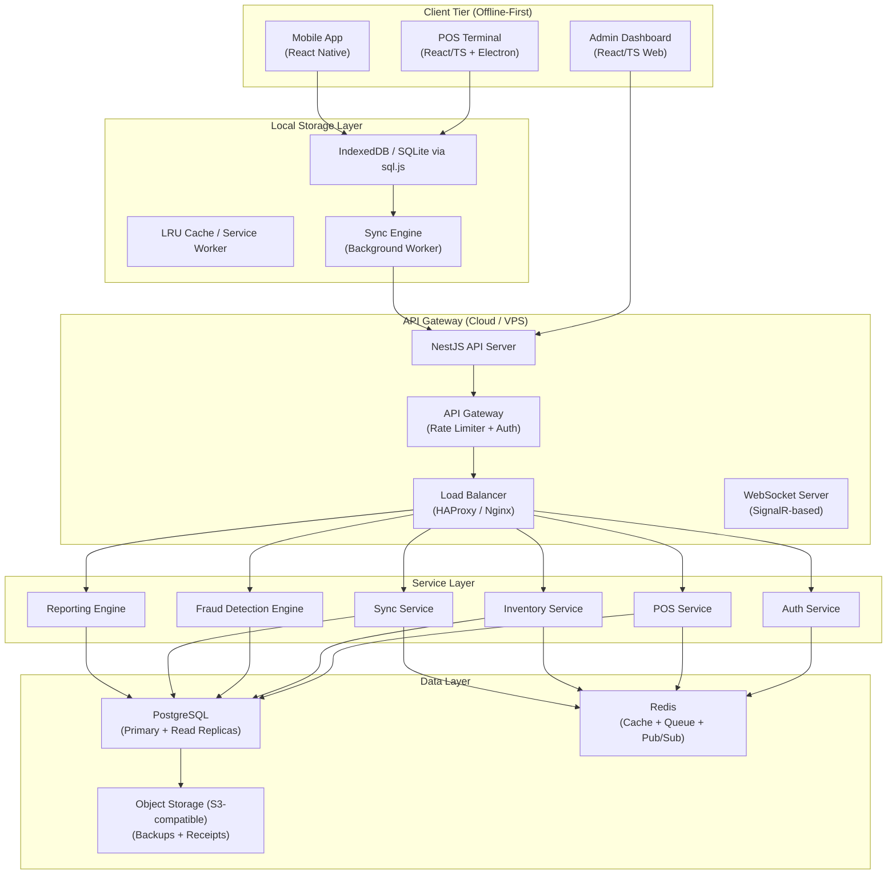
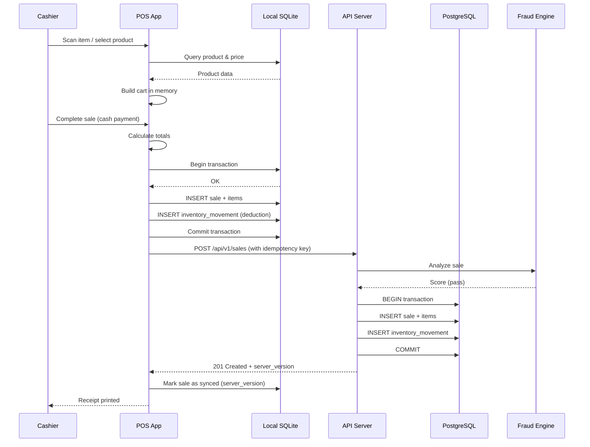
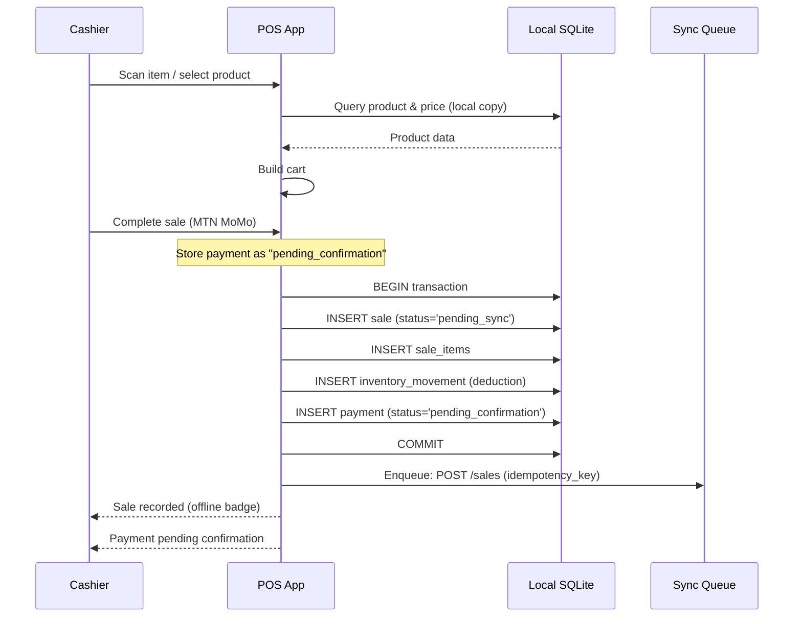
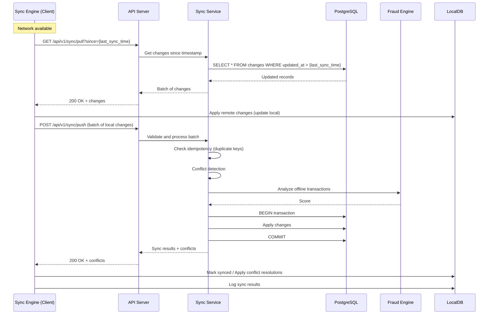

# System Architecture — RetailGuard

## 1. High-Level Architecture Diagram



## 2. Component Breakdown

### 2.1 Frontend (React/TypeScript + Electron)

The POS runs as an **Electron app** on Windows-based POS terminals. This gives us:
- Full offline SQLite via `sql.js` (WebAssembly-compiled SQLite)
- Direct filesystem access for receipt printing
- Native serial port access for barcode scanners
- Service worker integration for asset caching

**Runtime stack:**
- **React 18+** with TanStack Query for server state
- **Zustand** for client state (shift state, UI state)
- **TanStack Router** for routing
- **sql.js** (SQLite compiled to WASM) for local database
- **IndexedDB** via Dexie.js for blob storage (receipt images, sync metadata)
- **Workbox** for service worker / background sync

**Key design decisions:**
- All write operations go to local SQLite first, then sync
- Reads check local DB first, fall back to API if online
- UI is always optimistic — shows local state immediately
- Sync status is visible in a persistent indicator bar

### 2.2 Backend (Node.js + NestJS)

**Why NestJS over Go or plain Express:**
- Decorator-based architecture maps cleanly to our service boundaries
- Built-in dependency injection, guards, interceptors, pipes
- First-class WebSocket support via `@nestjs/websockets`
- Mature ORM integration (TypeORM / Prisma)
- TypeScript end-to-end (shared types with frontend)
- Go would be faster but slower to develop; we can migrate hot paths later

**Module structure:**
- `AuthModule` — JWT, refresh tokens, device trust, RBAC
- `POSModule` — Sales, payments, receipts, shift management
- `InventoryModule` — Stock movements, warehouse transfers, write-offs
- `SyncModule` — Conflict resolution, batch processing, idempotency
- `FraudModule` — Rule engine, scoring, alerts
- `AnalyticsModule` — Reporting, dashboards, exports
- `AdminModule` — Tenant management, user management, configuration

### 2.3 Database Layer

**PostgreSQL (Cloud):**
- Primary database with streaming replication to 2 read replicas
- Schema-per-tenant isolation via `tenant_id` on every table
- Row-level security (RLS) enabled for tenant isolation
- `pg_partman` for automatic partitioning of audit_logs, sync_logs, inventory_movements

**SQLite (Local/Offline):**
- Single file per POS terminal, stored in Electron's app data directory
- Schema mirrors the PostgreSQL schema with sync-specific metadata columns
- WAL mode for concurrent read/write performance
- Auto-vacuum enabled

### 2.4 Sync Engine

The sync engine is the most critical component. It runs as:
1. **Background worker** in the Electron app (JavaScript)
2. **Background thread** in React Native (via HeadlessJS)
3. **Server-side reconciliation service** (NestJS)

**Sync flow:**
```
Client: Record → Mark as dirty → Queue for sync → Batch upload → Receive confirmation
Server: Receive batch → Validate → Conflict detection → Resolve → Persist → Publish events
```

## 3. Data Flow Diagrams

### 3.1 Online Mode (Creating a Sale)



### 3.2 Offline Mode (Creating a Sale)



### 3.3 Sync When Online



## 4. Offline-First Architecture

### 4.1 Local Storage Strategy

**Three-tier local storage:**

| Tier | Technology | Purpose | Data |
|------|-----------|---------|------|
| Database | SQLite (sql.js) | Structured data | Products, prices, inventory, sales, users |
| Blob store | IndexedDB (Dexie) | Binary/large data | Receipt images, barcode images, sync metadata |
| Cache | Service Worker (Cache API) | Static assets | App shell, CSS, JS bundles, product images |

**SQLite configuration:**
```sql
PRAGMA journal_mode = WAL;        -- Write-Ahead Logging for concurrent access
PRAGMA synchronous = NORMAL;      -- Balance speed vs. durability
PRAGMA cache_size = -64000;       -- 64MB cache
PRAGMA foreign_keys = ON;         -- Enforce FK relationships
PRAGMA auto_vacuum = INCREMENTAL; -- Reclaim space periodically
```

### 4.2 Data Synchronization Model

**Sync metadata on every table:**
```
sync_status: 'pending' | 'synced' | 'conflict' | 'failed'
local_updated_at: timestamp (device clock)
server_id: uuid (assigned by server on first sync)
server_version: integer (monotonically increasing, per-row)
server_updated_at: timestamp (server clock, authoritative)
```

**Sync protocol:**
- **Pull-based** for reads: client polls for changes since last sync
- **Push-based** for writes: client sends batch of dirty records
- **Version vector** for conflict detection: each record has a server_version
- **Incremental sync**: only transfer records changed since last sync

### 4.3 Data Availability

| Data Type | Pre-loaded | Synced on demand | Created offline |
|-----------|-----------|-----------------|-----------------|
| Products & prices | Yes (full catalog) | Price updates | — |
| Users & roles | Yes (branch users) | User changes | — |
| Inventory (local branch) | Yes (current stock) | Stock adjustments | Movements |
| Sales | — | Recent 30 days | New sales |
| Customers | Top 1000 | New customers | New customers |
| Cash register | — | Shift data | Shift operations |

## 5. Conflict Resolution Strategy

### 5.1 Strategy: Last-Writer-Wins (LWW) with Branch-Scoped Ownership

**Why LWW over CRDTs:**
- CRDTs add complexity that is unnecessary for our domain
- Retail transactions are inherently sequential within a branch
- LWW with branch-scoped writes naturally avoids most conflicts
- CRDTs would require custom merge logic for inventory (where subtraction is not commutative)

**Ownership model:**
| Data Type | Owner | Write Authority |
|-----------|-------|----------------|
| Sales | Branch | Local branch only |
| Inventory (branch) | Branch | Local branch only |
| Inventory (warehouse) | Warehouse | Warehouse only |
| Products & prices | Head office | Admin only |
| Users & roles | Head office | Admin only |

**Conflict types and resolution:**

| Conflict Type | Scenario | Resolution |
|--------------|----------|------------|
| Inventory deduction | Two branches sell same item last in stock | Server rejects second with `insufficient_stock` |
| Price change during offline sale | Admin changes price while cashier is offline | Server applies sale price, flags for audit |
| Concurrent shift open | Cashier opens shift on two devices | Server rejects second, keeps first |
| Product deactivation | Admin deactivates product while offline sale uses it | Server rejects sale, cashier must reconcile |

### 5.2 Conflict Detection Algorithm

```
For each incoming record in sync batch:
  1. Look up record by server_id in database
  2. If not found → INSERT (new record, no conflict)
  3. If found:
     a. Compare server_version
     b. If incoming version > server version → UPDATE (no conflict, newer data)
     c. If incoming version <= server version:
        - Compare local_updated_at timestamps
        - If difference < 5 minutes → auto-resolve (LWW, server wins)
        - If difference > 5 minutes → flag as CONFLICT, require manual resolution
  4. For inventory movements:
     - Always process in order of server_version
     - If deduction would cause negative stock → CONFLICT (insufficient stock)
```

## 6. Major Architectural Decisions and Trade-offs

### Decision 1: SQLite (sql.js) over IndexedDB for Local Database

**Chosen:** SQLite via sql.js WASM
**Rejected:** IndexedDB (native browser storage)

**Rationale:**
- SQLite provides full SQL capabilities, JOINs, transactions, foreign keys
- sql.js is the same SQLite engine used on the server, ensuring SQL compatibility
- IndexedDB is a key-value store with no query language, making complex queries painful
- Trade-off: sql.js requires loading an ~2MB WASM file, which adds ~500ms to app startup

### Decision 2: REST over GraphQL

**Chosen:** REST API
**Rejected:** GraphQL

**Rationale:**
- Sync protocol is inherently batch-oriented (push/pull batches of records)
- GraphQL's request/response model doesn't map well to sync operations
- REST is simpler to cache, cache-invalidate, and debug
- Trade-off: GraphQL would reduce over-fetching, but sync batches are already optimized

### Decision 3: NestJS over Go

**Chosen:** NestJS (Node.js/TypeScript)
**Rejected:** Go

**Rationale:**
- Shared types between frontend and backend (TypeScript)
- Faster development velocity for a small team
- Rich ecosystem of libraries (TypeORM, validators, etc.)
- Trade-off: Go would provide ~5-10x better throughput and lower memory; hot paths can be migrated later

### Decision 4: LWW over CRDTs

**Chosen:** Last-Writer-Wins with branch-scoped ownership
**Rejected:** CRDTs (Conflict-free Replicated Data Types)

**Rationale:**
- CRDTs add significant complexity (merge functions, state management, testing)
- Retail data is naturally branch-scoped — conflicts are rare
- CRDTs for inventory would require non-standard merge logic (inventory decrement is not commutative)
- Trade-off: LWW can lose data in simultaneous writes; our audit log preserves all history

### Decision 5: Immutable Inventory Ledger

**Chosen:** Append-only inventory_movements table
**Rejected:** Mutable stock counts

**Rationale:**
- Every stock change is a recorded movement — never UPDATE, never DELETE
- Current stock is computed as SUM of movements
- Full audit trail: who changed what, when, and why
- Fraud detection can replay movements to detect anomalies
- Trade-off: Computing stock requires aggregation; mitigated by materialized views

### Decision 6: Tenant Isolation via tenant_id Column

**Chosen:** Shared database with tenant_id column on every table
**Rejected:** Separate database per tenant

**Rationale:**
- Easier to manage (one set of backups, one schema migration)
- Cross-tenant analytics (e.g., aggregate benchmarks) without cross-database queries
- Row-Level Security (RLS) provides tenant isolation at the database level
- Trade-off: Noisy neighbor problem; mitigated by connection pooling and query timeouts
- Migration path: separate databases for high-volume tenants when needed

### Decision 7: Payment Confirmation for Mobile Money

**Chosen:** Async payment confirmation with timeout
**Rejected:** Synchronous payment confirmation

**Rationale:**
- MTN MoMo and Orange Money APIs have variable latency (5-30 seconds)
- Offline mode cannot confirm payments at all
- Sale is recorded as "pending_confirmation" until payment webhook confirms
- Trade-off: Inventory is reserved but not deducted until payment confirmed; 15-minute timeout releases reservation

### Decision 8: Materialized Views for Inventory

**Chosen:** Materialized view `current_stock` refreshed periodically
**Rejected:** Real-time computation on every query

**Rationale:**
- Computing stock from movements on every query is expensive at scale
- Materialized view refreshes every 60 seconds (configurable)
- For critical operations (sale deduction), compute stock directly from movements
- Trade-off: Stale by up to 60 seconds; acceptable for most operations