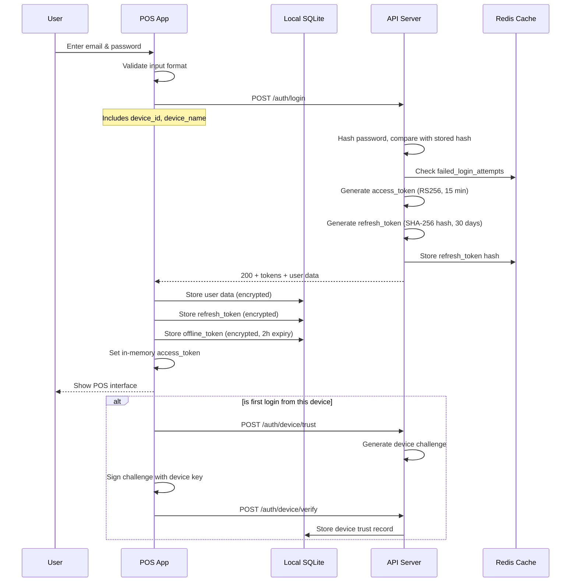
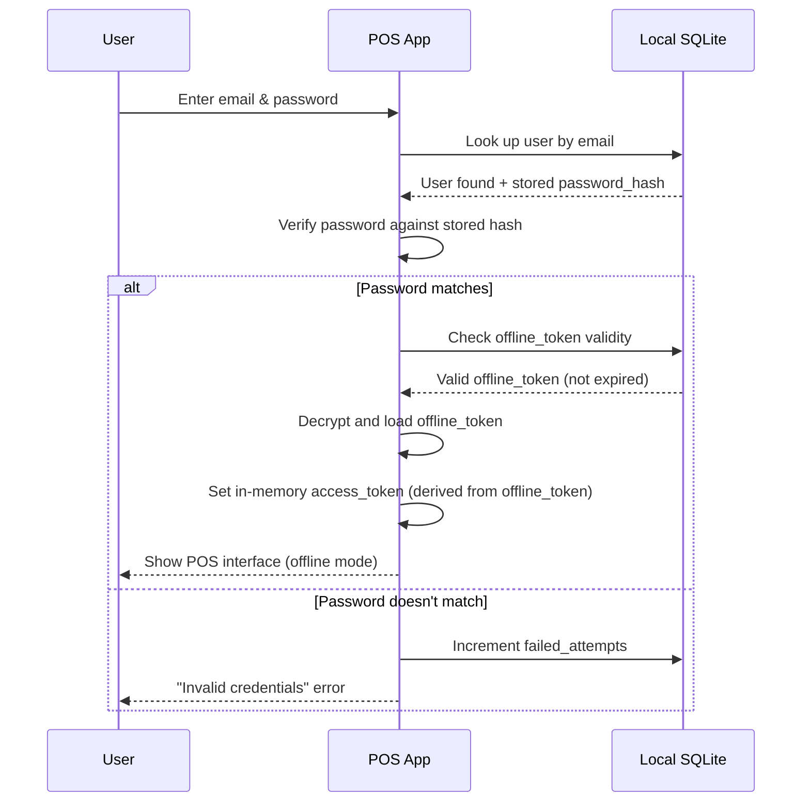
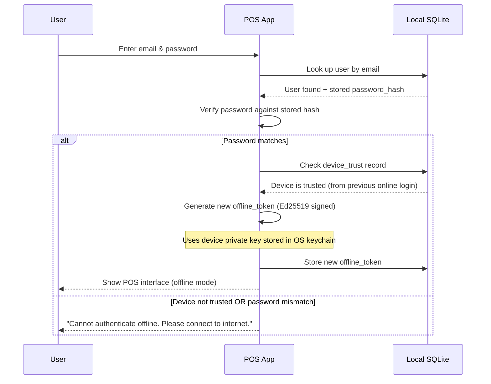

# Authentication Flow — RetailGuard

## 1. Overview

RetailGuard uses a **JWT + Refresh Token** authentication model with **Device Trust** for offline operation. The system supports three authentication modes:
1. **Online** — Full authentication against the server
2. **Offline (cached)** — Previously authenticated user with trusted device
3. **Offline (first-time)** — Device trust challenge-response

## 2. Token Architecture

### 2.1 Token Types

| Token | Type | Storage | Expiry | Purpose |
|-------|------|---------|--------|---------|
| Access Token | JWT (RS256) | Memory | 15 minutes | API authorization |
| Refresh Token | Opaque (SHA-256 hash) | Secure HTTP-only cookie | 30 days | Get new access token |
| Offline Token | JWT (Ed25519 signed) | Local SQLite (encrypted) | 2 hours | Offline API authorization |
| Device Trust Token | Opaque | Local SQLite (encrypted) | 30 days | Re-authenticate offline |

### 2.2 JWT Access Token Payload

```json
{
  "sub": "user_uuid",
  "tenant_id": "tenant_uuid",
  "branch_ids": ["branch_uuid_1", "branch_uuid_2"],
  "roles": ["cashier"],
  "permissions": ["sales.create", "sales.read", "inventory.read"],
  "device_id": "device_uuid",
  "type": "access",
  "iat": 1626600000,
  "exp": 1626600900
}
```

### 2.3 JWT Offline Token Payload

```json
{
  "sub": "user_uuid",
  "tenant_id": "tenant_uuid",
  "branch_ids": ["branch_uuid_1"],
  "roles": ["cashier"],
  "permissions": ["sales.create", "sales.read", "inventory.read"],
  "device_id": "device_uuid",
  "type": "offline",
  "offline_session_id": "session_uuid",
  "iat": 1626600000,
  "exp": 1626607200
}
```

## 3. Authentication Flow

### 3.1 Online Login



### 3.2 Offline Login (Cached)



### 3.3 Offline Login (First Time / Expired Token)

If the offline token is expired or this is the first offline login attempt:



## 4. Device Trust Mechanism

### 4.1 Device Registration

On first successful online login from a device:

1. POS generates an **Ed25519 key pair** and stores it in the OS keychain
2. POS sends the public key to the server via `POST /auth/device/trust`
3. Server stores the public key and returns a **challenge** (random nonce)
4. POS signs the challenge with the private key and sends it back
5. Server verifies the signature and marks the device as **trusted**
6. Server stores `device_trust` record with expiry (30 days, renewable)

### 4.2 Offline Authentication

When offline:
1. POS verifies the user's password against the locally stored password hash
2. POS checks if the device is trusted (local `device_trust` record exists and not expired)
3. If both pass, POS generates an **offline_token** (signed with device private key)
4. The offline token is stored in local SQLite (encrypted at rest)
5. All API calls during the offline session use this offline token
6. The offline token is valid for 2 hours, renewable while offline

### 4.3 Device Trust Renewal

When online:
1. Before the offline token expires, the sync engine checks if the device trust is still valid
2. If expiring soon, it sends a renewal request to the server
3. Server extends the device trust expiry (max 30 days from last renewal)
4. If the device trust has expired, the user must re-authenticate online

## 5. RBAC Model

### 5.1 Roles

| Role | Scope | Description |
|------|-------|-------------|
| `super_admin` | Global | System-wide access, all tenants |
| `admin` | Tenant | Full tenant access, user management, configuration |
| `manager` | Branch(es) | Branch management, reports, approvals |
| `supervisor` | Branch | Override sales, void transactions, close shifts |
| `cashier` | Branch | Process sales, open/close shift, basic reports |
| `warehouse_staff` | Warehouse | Inventory management, transfers, receiving |
| `auditor` | Tenant | Read-only access to all data, audit logs |
| `viewer` | Branch | Read-only access to branch data |

### 5.2 Permissions Matrix

| Permission | super_admin | admin | manager | supervisor | cashier | warehouse | auditor | viewer |
|------------|:-----------:|:-----:|:-------:|:----------:|:-------:|:---------:|:-------:|:------:|
| **Sales** | | | | | | | | |
| `sales.create` | ✅ | ✅ | ✅ | ✅ | ✅ | ❌ | ❌ | ❌ |
| `sales.read` | ✅ | ✅ | ✅ | ✅ | ✅ | ❌ | ✅ | ✅ |
| `sales.void` | ✅ | ✅ | ✅ | ✅ | ❌ | ❌ | ❌ | ❌ |
| `sales.void_approve` | ✅ | ✅ | ✅ | ✅ | ❌ | ❌ | ❌ | ❌ |
| `sales.refund` | ✅ | ✅ | ✅ | ✅ | ❌ | ❌ | ❌ | ❌ |
| **Shifts** | | | | | | | | |
| `shift.open` | ✅ | ✅ | ✅ | ✅ | ✅ | ❌ | ❌ | ❌ |
| `shift.close` | ✅ | ✅ | ✅ | ✅ | ✅ | ❌ | ❌ | ❌ |
| `shift.read` | ✅ | ✅ | ✅ | ✅ | ✅ | ❌ | ✅ | ✅ |
| `shift.approve` | ✅ | ✅ | ✅ | ✅ | ❌ | ❌ | ❌ | ❌ |
| **Inventory** | | | | | | | | |
| `inventory.read` | ✅ | ✅ | ✅ | ✅ | ✅ | ✅ | ✅ | ✅ |
| `inventory.movement.create` | ✅ | ✅ | ✅ | ❌ | ❌ | ✅ | ❌ | ❌ |
| `inventory.transfer.create` | ✅ | ✅ | ✅ | ❌ | ❌ | ✅ | ❌ | ❌ |
| `inventory.transfer.approve` | ✅ | ✅ | ✅ | ❌ | ❌ | ❌ | ❌ | ❌ |
| `inventory.transfer.receive` | ✅ | ✅ | ✅ | ✅ | ❌ | ✅ | ❌ | ❌ |
| `inventory.stock_count` | ✅ | ✅ | ✅ | ✅ | ❌ | ✅ | ❌ | ❌ |
| **Expenses** | | | | | | | | |
| `expense.create` | ✅ | ✅ | ✅ | ✅ | ✅ | ❌ | ❌ | ❌ |
| `expense.approve` | ✅ | ✅ | ✅ | ✅ | ❌ | ❌ | ❌ | ❌ |
| `expense.read` | ✅ | ✅ | ✅ | ✅ | ✅ | ❌ | ✅ | ✅ |
| **Damages** | | | | | | | | |
| `damage.report` | ✅ | ✅ | ✅ | ✅ | ❌ | ✅ | ❌ | ❌ |
| `damage.approve` | ✅ | ✅ | ✅ | ✅ | ❌ | ❌ | ❌ | ❌ |
| `damage.read` | ✅ | ✅ | ✅ | ✅ | ❌ | ✅ | ✅ | ✅ |
| **Admin** | | | | | | | | |
| `users.manage` | ✅ | ✅ | ❌ | ❌ | ❌ | ❌ | ❌ | ❌ |
| `roles.manage` | ✅ | ✅ | ❌ | ❌ | ❌ | ❌ | ❌ | ❌ |
| `branches.manage` | ✅ | ✅ | ❌ | ❌ | ❌ | ❌ | ❌ | ❌ |
| `products.manage` | ✅ | ✅ | ✅ | ❌ | ❌ | ❌ | ❌ | ❌ |
| `prices.manage` | ✅ | ✅ | ✅ | ❌ | ❌ | ❌ | ❌ | ❌ |
| **Fraud** | | | | | | | | |
| `fraud.read` | ✅ | ✅ | ✅ | ✅ | ❌ | ❌ | ✅ | ❌ |
| `fraud.resolve` | ✅ | ✅ | ✅ | ❌ | ❌ | ❌ | ❌ | ❌ |
| **Analytics** | | | | | | | | |
| `analytics.read` | ✅ | ✅ | ✅ | ✅ | ✅ | ✅ | ✅ | ✅ |
| `analytics.export` | ✅ | ✅ | ✅ | ✅ | ❌ | ✅ | ✅ | ❌ |
| **Audit** | | | | | | | | |
| `audit.read` | ✅ | ✅ | ❌ | ❌ | ❌ | ❌ | ✅ | ❌ |
| **Sync** | | | | | | | | |
| `sync.manage` | ✅ | ✅ | ❌ | ❌ | ❌ | ❌ | ❌ | ❌ |

## 6. Session Management

### 6.1 Session Lifecycle

1. **Login** → Creates a session (stored in Redis with TTL matching refresh token)
2. **Each API call** → Validates access token (JWT, stateless)
3. **Token expiry** → Client uses refresh token to get new access token
4. **Logout** → Revokes refresh token, deletes offline token, removes device trust
5. **Password change** → Revokes ALL sessions for that user, forces re-login

### 6.2 Session Storage

```
Redis key: session:{user_id}:{device_id}
Value: {
  "refresh_token_hash": "...",
  "device_id": "...",
  "ip_address": "...",
  "last_activity": "2026-07-18T12:00:00Z",
  "is_trusted": true
}
TTL: 30 days (matching refresh token expiry)
```

### 6.3 Concurrent Sessions

- Users can be logged in on multiple devices simultaneously
- Each device has its own session (separate refresh token)
- Admin can revoke specific sessions (e.g., lost device)
- Max concurrent sessions per user: 5 (configurable)

### 6.4 Session Revocation

**Triggers:**
- User explicitly logs out
- Password changed
- Admin revokes session
- Device trust expired
- Account locked (too many failed attempts)
- Account deactivated

**Revocation process:**
1. Delete refresh token from Redis
2. Delete device trust record
3. Client's next API call with expired/invalid token → 401
4. Client must re-authenticate

## 7. Password Policy

```typescript
const PASSWORD_POLICY = {
  minLength: 8,
  maxLength: 128,
  requireUppercase: true,
  requireLowercase: true,
  requireNumber: true,
  requireSpecialChar: true,
  maxFailedAttempts: 5,
  lockoutDurationMinutes: 15,
  passwordHistory: 5,         // Cannot reuse last 5 passwords
  expiryDays: 90,             // Password expires after 90 days
  hashAlgorithm: 'bcrypt',
  bcryptRounds: 12
};
```

## 8. Error Handling

### 8.1 Authentication Errors

| Error Code | HTTP Status | Description | Recovery |
|------------|------------|-------------|----------|
| INVALID_CREDENTIALS | 401 | Email or password incorrect | Try again |
| ACCOUNT_LOCKED | 423 | Too many failed attempts | Wait 15 minutes |
| TOKEN_EXPIRED | 401 | Access token expired | Use refresh token |
| INVALID_REFRESH_TOKEN | 401 | Refresh token expired/revoked | Re-authenticate |
| DEVICE_NOT_TRUSTED | 401 | Device not trusted for offline | Connect online first |
| OFFLINE_TOKEN_EXPIRED | 401 | Offline token expired | Connect online or re-authenticate |
| PASSWORD_EXPIRED | 401 | Password needs changing | Change password |
| SESSION_REVOKED | 401 | Session revoked by admin | Re-authenticate |

### 8.2 Offline Error Recovery

```
Offline login failure:
  1. Can't verify password → show "No internet connection. Cannot verify credentials."
  2. Device not trusted → show "First-time login requires internet connection."
  3. Offline token expired → show "Session expired. Connect to internet to re-authenticate."

Online recovery after offline:
  1. Sync engine detects network available
  2. Checks if offline_token is still valid
  3. If expired, uses refresh_token to get new tokens
  4. If refresh_token expired, shows "Please log in again" prompt
  5. User re-authenticates → new tokens → sync resumes
```