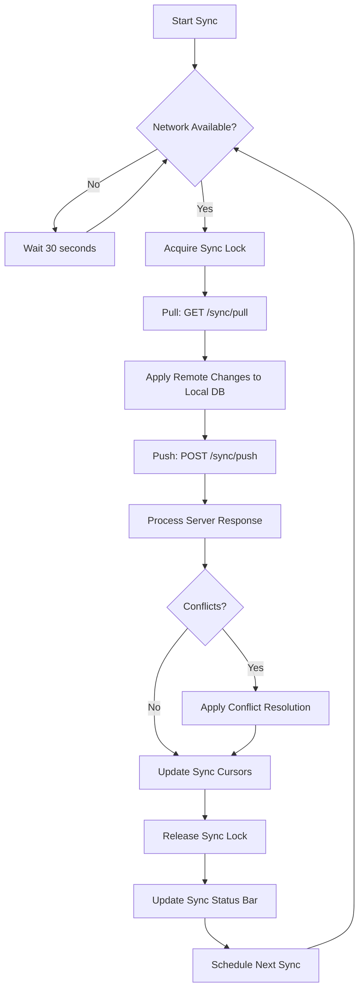

# Offline Sync Architecture — RetailGuard

## 1. Sync Protocol Design

### 1.1 Protocol Overview

The sync protocol is a **client-initiated, bidirectional, batch-oriented** protocol. The client is always the initiator — the server never pushes changes to the client. Instead, the client polls for changes at regular intervals.

**Protocol characteristics:**
- **Transport**: HTTPS (REST)
- **Format**: JSON
- **Authentication**: JWT (or offline token)
- **Direction**: Bidirectional (push local changes, pull remote changes)
- **Granularity**: Record-level
- **Consistency**: Eventual

### 1.2 Sync Flow



### 1.3 Sync Priority

Records are synced in priority order:

| Priority | Data Type | Reason |
|----------|-----------|--------|
| 1 (Highest) | Device trust renewal | Needed for continued offline operation |
| 2 | Offline sales | Revenue-critical, fraud-sensitive |
| 3 | Inventory movements | Stock accuracy |
| 4 | Shift operations | Cash reconciliation |
| 5 | Expense records | Operational cost tracking |
| 6 | Damage reports | Inventory write-off |
| 7 | Product/price updates | Fresh data for next sale |
| 8 | User/role updates | Security |
| 9 | Analytics data | Reporting |

## 2. Conflict Detection and Resolution

### 2.1 Version Vectors

Every synced record has a `server_version` integer that starts at 0 (unsynced) and increments by 1 on each server-side update.

```typescript
interface SyncableRecord {
  id: string;
  tenant_id: string;
  // ... domain fields ...
  server_version: number;  // 0 = unsynced, 1+ = server-assigned
  server_id: string;       // Assigned by server on first sync
  local_updated_at: string; // ISO timestamp from device clock
  sync_status: 'pending' | 'synced' | 'conflict' | 'failed';
}
```

### 2.2 Conflict Detection Algorithm

```
SERVER-SIDE CONFLICT DETECTION:

For each incoming record in sync push batch:
  Input: { table, record, idempotency_key, operation }

  Step 1: Check idempotency
    - Look up idempotency_key in Redis
    - If found → return cached result (no conflict check needed)
    - If not found → continue

  Step 2: Check if record exists
    - Look up by server_id (which is the record's id if already synced)
    - If not found → INSERT (no conflict, create new record)

  Step 3: Version comparison
    - If incoming.server_version > stored.server_version:
      → UPDATE with incoming data (LWW)
    - If incoming.server_version == stored.server_version:
      → Check timestamps
        - If |incoming.local_updated_at - stored.updated_at| < 5 minutes:
          → Auto-resolve: server wins (LWW)
        - If |incoming.local_updated_at - stored.updated_at| >= 5 minutes:
          → CONFLICT: flag for manual resolution
    - If incoming.server_version < stored.server_version:
      → CONFLICT: server has newer data

  Step 4: Business rule validation
    - For sales: check inventory availability
    - For inventory: check stock doesn't go negative (unless permitted)
    - For shifts: check no concurrent open shift
    - For prices: check minimum price policy
    - If any rule fails → CONFLICT with specific error

  Step 5: Return result
    - { status: 'created' | 'updated' | 'conflict', conflict_type, resolution }
```

### 2.3 Conflict Types and Resolutions

| Conflict Type | Detection | Auto-Resolve | Manual Resolution |
|--------------|-----------|-------------|-------------------|
| `insufficient_stock` | Negative stock after deduction | No | Reject sale, notify cashier, adjust inventory |
| `price_changed` | Selling price differs from current price | Server wins (use current price) | Supervisor reviews discount |
| `product_deactivated` | Product no longer active | Reject sale | Supervisor re-activates or rejects |
| `shift_already_closed` | Shift closed by another device | Use server shift state | Reconcile offline sales to new shift |
| `concurrent_shift_open` | Two shifts open for same cashier | Reject second | Close extra shift |
| `version_conflict` | Version mismatch > 5 minutes | No | Manual review of both versions |
| `duplicate_receipt` | Receipt number already exists | Auto-assign new receipt number | Notify admin |
| `negative_inventory` | Stock would go negative | Reject | Supervisor override or correction |

### 2.4 Conflict Storage

Conflicts are stored in the `sync_conflicts` table:

```sql
CREATE TABLE sync_conflicts (
    id UUID PRIMARY KEY DEFAULT gen_random_uuid(),
    tenant_id UUID NOT NULL,
    branch_id UUID REFERENCES branches(id),
    table_name VARCHAR(100) NOT NULL,
    record_id UUID NOT NULL,
    conflict_type VARCHAR(100) NOT NULL,
    server_version INTEGER NOT NULL,           -- Server's version at conflict time
    client_data JSONB NOT NULL,                 -- What the client sent
    server_data JSONB,                          -- What the server has (if applicable)
    resolution VARCHAR(50) DEFAULT 'pending'
        CHECK (resolution IN ('pending', 'auto_resolved', 'manual_resolved', 'rejected', 'overridden')),
    resolved_by UUID REFERENCES users(id),
    resolved_at TIMESTAMPTZ,
    resolution_notes TEXT,
    created_at TIMESTAMPTZ NOT NULL DEFAULT NOW(),
    updated_at TIMESTAMPTZ NOT NULL DEFAULT NOW()
);

CREATE INDEX idx_sync_conflicts_tenant ON sync_conflicts(tenant_id, created_at DESC);
CREATE INDEX idx_sync_conflicts_branch ON sync_conflicts(branch_id, tenant_id);
CREATE INDEX idx_sync_conflicts_resolution ON sync_conflicts(resolution) WHERE resolution = 'pending';
```

## 3. Background Sync with Retry

### 3.1 Sync Engine Architecture (Client-Side)

The sync engine runs as a background worker in the Electron main process:

```typescript
class SyncEngine {
  private isRunning: boolean = false;
  private syncInterval: number = 30000; // 30 seconds
  private maxRetries: number = 5;
  private backoffBase: number = 1000; // 1 second
  private syncLock: Mutex = new Mutex();
  private queue: PriorityQueue = new PriorityQueue();

  async start(): Promise<void> {
    this.isRunning = true;
    this.scheduleNextSync();
  }

  async stop(): Promise<void> {
    this.isRunning = false;
  }

  private scheduleNextSync(): void {
    if (!this.isRunning) return;
    setTimeout(() => this.runSync(), this.syncInterval);
  }

  private async runSync(): Promise<void> {
    const release = await this.syncLock.acquire();
    try {
      if (!await this.isOnline()) {
        this.scheduleNextSync();
        return;
      }

      // Phase 1: Pull remote changes
      await this.pullChanges();

      // Phase 2: Push local changes
      await this.pushChanges();

      // Phase 3: Process conflicts
      await this.processConflicts();

      // Update sync status
      this.updateSyncStatusBar();
    } catch (error) {
      await this.handleSyncError(error);
    } finally {
      release();
      this.scheduleNextSync();
    }
  }
}
```

### 3.2 Retry Logic with Exponential Backoff

```typescript
async function syncWithRetry(
  operation: () => Promise<SyncResult>,
  idempotencyKey: string,
  maxRetries: number = 5
): Promise<SyncResult> {
  let lastError: Error | null = null;

  for (let attempt = 0; attempt <= maxRetries; attempt++) {
    try {
      return await operation();
    } catch (error) {
      lastError = error;

      if (attempt < maxRetries) {
        const delay = Math.min(
          Math.pow(2, attempt) * 1000 + Math.random() * 1000, // Exponential backoff + jitter
          30000 // Max 30 seconds
        );
        await sleep(delay);
      }
    }
  }

  // All retries exhausted
  await recordSyncFailure(idempotencyKey, lastError!.message);
  throw lastError;
}
```

### 3.3 Retry Queue

Failed sync operations are queued for retry:

```typescript
interface SyncQueueItem {
  id: number;
  tableName: string;
  recordId: string;
  operation: 'create' | 'update' | 'delete';
  payload: Record<string, unknown>;
  idempotencyKey: string;
  status: 'pending' | 'syncing' | 'synced' | 'failed' | 'conflict';
  retryCount: number;
  maxRetries: number;
  lastError: string | null;
  createdAt: string;
}

// SQLite: sync_queue table
// Automatically retried on each sync cycle
// After maxRetries exhausted, status = 'failed', requires manual intervention
```

## 4. Duplicate Request Protection (Idempotency Keys)

### 4.1 Idempotency Key Generation

```typescript
function generateIdempotencyKey(
  tableName: string,
  recordId: string,
  operation: string
): string {
  const raw = `${tableName}:${recordId}:${operation}:${deviceId}`;
  return crypto.createHash('sha256').update(raw).digest('hex');
}
```

### 4.2 Server-Side Idempotency Check

```typescript
// Redis-based idempotency cache (TTL: 24 hours)
async function checkIdempotency(
  key: string,
  requestBody: Record<string, unknown>
): Promise<{ duplicate: boolean; cachedResponse?: SyncResult }> {
  const cached = await redis.get(`idempotency:${key}`);

  if (!cached) {
    return { duplicate: false };
  }

  const { body, response } = JSON.parse(cached);

  // Verify same request body (prevent replay with different data)
  if (hashBody(body) === hashBody(requestBody)) {
    return { duplicate: true, cachedResponse: response };
  }

  // Different body with same key → possible replay attack
  throw new IdempotencyReplayError(key);
}

async function storeIdempotency(
  key: string,
  requestBody: Record<string, unknown>,
  response: SyncResult
): Promise<void> {
  await redis.set(
    `idempotency:${key}`,
    JSON.stringify({ body: requestBody, response }),
    'EX',
    86400 // 24 hours TTL
  );
}
```

### 4.3 Client-Side Idempotency

```typescript
// Before pushing to server, store idempotency key locally
async function enqueueSyncOperation(
  tableName: string,
  recordId: string,
  operation: string,
  payload: Record<string, unknown>
): Promise<void> {
  const idempotencyKey = generateIdempotencyKey(tableName, recordId, operation);

  // Check if already in queue
  const existing = await localDb.get(
    'SELECT id FROM sync_queue WHERE idempotency_key = ?',
    [idempotencyKey]
  );

  if (existing) {
    // Update existing record (don't create duplicate)
    await localDb.run(
      'UPDATE sync_queue SET payload = ?, updated_at = datetime("now") WHERE idempotency_key = ?',
      [JSON.stringify(payload), idempotencyKey]
    );
    return;
  }

  // Insert new queue item
  await localDb.run(
    `INSERT INTO sync_queue (table_name, record_id, operation, payload, idempotency_key, status)
     VALUES (?, ?, ?, ?, ?, 'pending')`,
    [tableName, recordId, operation, JSON.stringify(payload), idempotencyKey]
  );
}
```

## 5. Crash Recovery

### 5.1 Operation Log

Every critical operation is logged to the `operation_log` table in SQLite before execution:

```typescript
async function executeWithCrashRecovery<T>(
  operationName: string,
  inputParams: Record<string, unknown>,
  executor: () => Promise<T>
): Promise<T> {
  // Log operation start
  const logId = await localDb.run(
    `INSERT INTO operation_log (operation_name, input_params, status)
     VALUES (?, ?, 'started')`,
    [operationName, JSON.stringify(inputParams)]
  );

  try {
    const result = await executor();

    // Mark as completed
    await localDb.run(
      `UPDATE operation_log SET status = 'completed', completed_at = datetime('now')
       WHERE id = ?`,
      [logId]
    );

    return result;
  } catch (error) {
    // Mark as failed
    await localDb.run(
      `UPDATE operation_log SET status = 'failed', error_message = ? WHERE id = ?`,
      [(error as Error).message, logId]
    );

    // Rollback any partial changes
    await rollbackOperation(operationName, inputParams);

    throw error;
  }
}
```

### 5.2 Crash Recovery on Startup

When the POS app starts, it checks for incomplete operations:

```typescript
async function recoverFromCrash(): Promise<void> {
  // Find all operations that were 'started' but not 'completed'
  const incompleteOps = await localDb.all(
    `SELECT * FROM operation_log WHERE status = 'started'
     ORDER BY created_at ASC`
  );

  for (const op of incompleteOps) {
    try {
      await rollbackOperation(op.operation_name, JSON.parse(op.input_params));

      await localDb.run(
        `UPDATE operation_log SET status = 'failed', error_message = 'Crash recovery rollback'
         WHERE id = ?`,
        [op.id]
      );
    } catch (error) {
      console.error(`Failed to rollback operation ${op.id}:`, error);
      // Log to error file for manual review
    }
  }
}
```

### 5.3 Sync State Persistence

Sync state is persisted to SQLite so it survives a crash:

```typescript
// Sync cursors survive crashes
interface SyncCursors {
  [tableName: string]: {
    lastSyncedAt: string;
    lastServerVersion: number;
  };
}

// Sync queue items survive crashes (stored in SQLite)
// Sync lock is released on crash (Mutex with timeout)
```

## 6. Sync Engine: What to Sync, In What Order

### 6.1 Pull Phase (Server → Client)

```typescript
async function pullChanges(): Promise<void> {
  // 1. Get last sync cursor for each table
  const cursors = await this.getSyncCursors();

  // 2. Request changes since cursor
  const response = await api.get('/sync/pull', {
    params: {
      device_id: this.deviceId,
      branch_id: this.branchId,
      since: cursors.global.lastSyncedAt,
      tables: this.getSyncableTables()
    }
  });

  // 3. Apply changes in order of dependency
  // Order matters: parent tables before child tables
  const applyOrder = [
    'products',           // Products first (no dependencies)
    'product_categories', // Categories before products (if FK)
    'product_prices',     // Prices after products
    'users',              // Users before references
    'branches',           // Branches before user/branch assignments
    'warehouses',         // Independent
    'roles',              // Independent
    'inventory_movements', // Movements after products
    'sales',              // Sales after products, users, branches
    'sale_items',         // After sales
    'payments',           // After sales
    'shifts',             // After users, branches
    'expenses',           // After shifts, branches
    'damage_reports',     // After products, branches
    'warehouse_transfers', // After branches, warehouses
    'transfer_items',     // After transfers
    'fraud_alerts',       // Last (no downstream dependencies)
    'sync_conflicts'      // Last
  ];

  for (const table of applyOrder) {
    const changes = response.changes[table];
    if (!changes) continue;

    // Apply updated records
    for (const record of changes.updated) {
      await this.applyRemoteUpdate(table, record);
    }

    // Apply deleted records (soft delete)
    for (const id of changes.deleted) {
      await this.applyRemoteDelete(table, id);
    }

    // Update cursor for this table
    if (changes.updated.length > 0 || changes.deleted.length > 0) {
      await this.updateSyncCursor(table, changes.cursor);
    }
  }

  // 4. Update global cursor
  await this.updateGlobalCursor(response.server_time);
}
```

### 6.2 Push Phase (Client → Server)

```typescript
async function pushChanges(): Promise<void> {
  // 1. Get all pending sync queue items, ordered by priority
  const pendingItems = await localDb.all(
    `SELECT sq.*, sp.priority FROM sync_queue sq
     LEFT JOIN sync_priorities sp ON sq.table_name = sp.table_name
     WHERE sq.status = 'pending'
     ORDER BY sp.priority ASC, sq.created_at ASC
     LIMIT 100`
  );

  if (pendingItems.length === 0) return;

  // 2. Batch items by table for efficient processing
  const batches = this.groupByTable(pendingItems);

  // 3. Push to server
  for (const [table, items] of Object.entries(batches)) {
    const batch = items.map(item => ({
      table: item.table_name,
      operation: item.operation,
      record: JSON.parse(item.payload),
      idempotency_key: item.idempotency_key,
      local_updated_at: item.created_at
    }));

    // Mark as syncing
    await this.markItemsAsSyncing(items.map(i => i.id));

    try {
      const response = await api.post('/sync/push', {
        device_id: this.deviceId,
        branch_id: this.branchId,
        batch
      });

      // Process results
      for (const result of response.results) {
        const item = items.find(i => i.idempotency_key === result.idempotency_key);
        if (!item) continue;

        switch (result.status) {
          case 'created':
          case 'updated':
            await this.markAsSynced(item, result.server_id, result.server_version);
            break;
          case 'conflict':
            await this.handleConflict(item, result);
            break;
          case 'rejected':
            await this.markAsFailed(item, result.message);
            break;
        }
      }
    } catch (error) {
      // Network error — keep items as 'pending' for retry
      await this.markItemsAsPending(items.map(i => i.id));
      throw error;
    }
  }
}
```

### 6.3 Sync Scheduling

```typescript
const SYNC_CONFIG = {
  // Normal operation
  onlineInterval: 30000,           // Sync every 30 seconds when online
  offlineRetryInterval: 60000,     // Check for connectivity every 60 seconds
  pullInterval: 120000,            // Full pull every 2 minutes

  // Urgent sync (after critical operation)
  urgentSyncDelay: 2000,           // Wait 2 seconds before urgent sync

  // Error handling
  maxRetries: 5,
  backoffBase: 1000,
  backoffMax: 30000,

  // Batch size
  maxBatchSize: 100,               // Max records per push batch

  // Queue management
  maxQueueSize: 10000,             // Max queued items before warning
  maxQueueAge: 86400000,           // 24 hours — items older than this are flagged
};
```

## 7. Sync Data Integrity

### 7.1 Checksums

Every sync batch includes a checksum to detect data corruption:

```typescript
function calculateBatchChecksum(batch: SyncBatchItem[]): string {
  const json = JSON.stringify(batch.map(item => ({
    table: item.table,
    id: item.record.id,
    operation: item.operation,
    idempotency_key: item.idempotency_key
  })));
  return crypto.createHash('sha256').update(json).digest('hex');
}
```

### 7.2 Sync Health Monitoring

```typescript
interface SyncHealth {
  deviceId: string;
  lastSuccessfulSync: string | null;
  lastFailedSync: string | null;
  pendingPushCount: number;
  pendingPullCount: number;
  conflictsCount: number;
  failedCount: number;
  isOnline: boolean;
  consecutiveFailures: number;
  averageSyncDuration: number; // ms
}

// Health check runs on every sync cycle
// If consecutiveFailures > 3 → alert admin
// If pendingPushCount > 1000 → alert admin
// If conflictsCount > 10 → alert admin
// If lastSuccessfulSync > 2 hours → alert admin
```

## 8. Error Handling

### 8.1 Sync Error Codes

| Error Code | Description | Recovery |
|------------|-------------|----------|
| NETWORK_ERROR | No network available | Retry with backoff |
| SERVER_ERROR | Server returned 5xx | Retry with backoff |
| RATE_LIMITED | Server returned 429 | Retry after delay |
| AUTH_ERROR | Token expired/revoked | Re-authenticate |
| VALIDATION_ERROR | Record failed validation | Flag for manual review |
| CONFLICT | Version conflict | Apply conflict resolution |
| IDEMPOTENCY_REPLAY | Idempotency key reused | Investigate |
| BATCH_TOO_LARGE | Batch exceeds limit | Split and retry |
| DATA_CORRUPTION | Checksum mismatch | Re-pull and retry |

### 8.2 Error Recovery Strategy

```typescript
async function handleSyncError(error: SyncError): Promise<void> {
  this.consecutiveFailures++;

  switch (error.code) {
    case 'NETWORK_ERROR':
      // No action — will retry in next sync cycle
      break;

    case 'SERVER_ERROR':
      // Exponential backoff
      this.syncInterval = Math.min(
        this.syncInterval * 2,
        300000 // Max 5 minutes
      );
      break;

    case 'AUTH_ERROR':
      // Try to refresh token
      const refreshed = await this.tryRefreshToken();
      if (!refreshed) {
        this.emit('auth_required');
        this.stop();
      }
      break;

    case 'DATA_CORRUPTION':
      // Full re-sync
      await this.resetSyncCursors();
      break;

    default:
      // Log and continue
      await this.logSyncError(error);
  }

  if (this.consecutiveFailures > 10) {
    this.emit('sync_failure', {
      message: 'Sync has failed 10 consecutive times',
      lastError: error
    });
  }
}
```