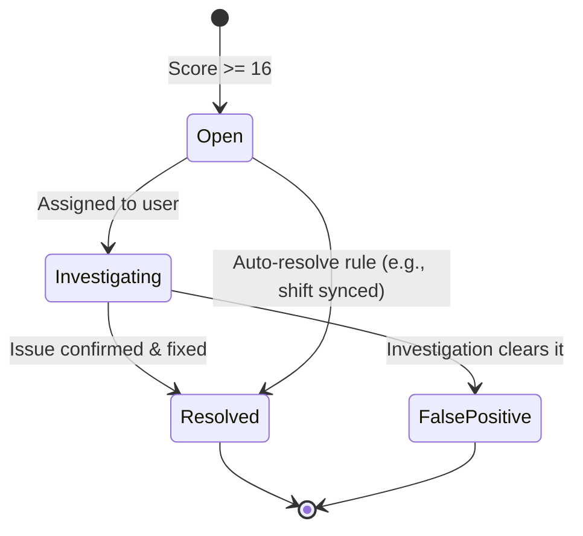
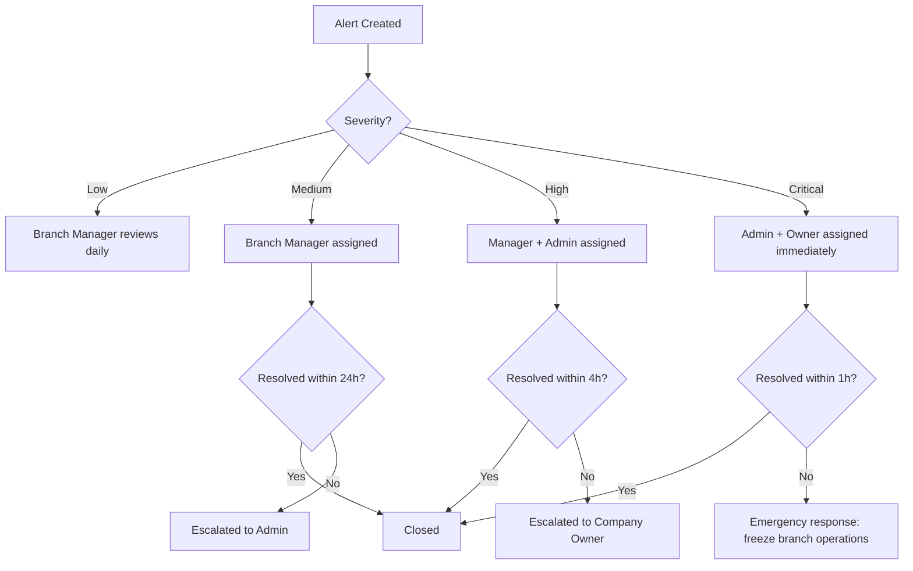

# Fraud Detection Architecture — RetailGuard

## 1. Design Principles

1. **Run everywhere** — Fraud detection must work both online (server-side, full analysis) and offline (client-side, cached rules with local scoring).
2. **Non-blocking** — Fraud scoring never blocks a sale. It runs asynchronously after the transaction is recorded. Only extreme rule violations (e.g., price below cost) may trigger a pre-sale warning.
3. **Configurable per tenant** — Thresholds, score weights, and alert severity are tenant-configurable via `tenants.config` JSONB field.
4. **Immutable audit trail** — Every detected anomaly is logged permanently. Alert state can change (resolved, false_positive) but the detection record is never deleted.
5. **Human-in-the-loop** — Automated detection raises alerts. Resolution always requires a human decision.
6. **Offline-first** — Rule definitions and cached scores are downloaded to the POS terminal so detection runs even without connectivity.

## 2. Detection Rules

### 2.1 Cash Shortage Detection

**Rule:** Compare the shift's expected cash balance (calculated from sales + opening balance) against the declared closing balance.

```typescript
interface CashShortageRule {
  type: 'cash_shortage';
  // Triggers when |discrepancy| / expected_balance > threshold
  thresholds: {
    low: 0.005;       // 0.5% — default branch threshold (matches shifts table)
    medium: 0.02;     // 2%
    high: 0.05;       // 5%
    critical: 0.10;   // 10%
  };
  // Also flag if absolute discrepancy exceeds this amount regardless of percentage
  absolute_threshold_xaf: 10000;  // 10,000 XAF
}
```

**Detection logic:**
1. On shift close, calculate `expected_balance = opening_balance + total_cash_sales - total_cash_expenses`
2. Compare with `declared_closing_balance` (cash declaration + cash from shift expenses)
3. `discrepancy = declared_closing_balance - expected_balance`
4. `discrepancy_percentage = |discrepancy| / expected_balance * 100`
5. Score contribution: `min(discrepancy_percentage / threshold * 25, 25)` max 25 points

**Detection timing:**
- **Online:** Immediately on shift close POST (server-side)
- **Offline:** Locally on shift close, alert queued in sync_queue for confirmation on sync

### 2.2 Inventory Mismatch Detection

**Rule:** Detect discrepancies between physical stock counts and expected stock (computed from inventory_movements).

```typescript
interface InventoryMismatchRule {
  type: 'inventory_mismatch';
  thresholds: {
    low: 0.01;        // 1% variance
    medium: 0.03;     // 3%
    high: 0.05;       // 5%
    critical: 0.10;   // 10%
  };
  // Minimum absolute variance to flag (prevents noise on high-volume items)
  min_absolute_variance: 2;  // In stock_unit
}
```

**Detection logic:**
1. On stock count submission, compare `counted_quantity` vs `expected_quantity` (SUM of movements)
2. `variance = |counted_quantity - expected_quantity|`
3. `variance_percentage = variance / expected_quantity * 100`
4. If variance > min_absolute_variance AND variance_percentage > threshold → alert
5. Score contribution: `min(variance_percentage / threshold * 20, 20)` max 20 points

**Payload context:**
```json
{
  "product_id": "uuid",
  "product_name": "Ceramic Tile 60x60",
  "expected_quantity": 84.5,
  "counted_quantity": 78.0,
  "variance": -6.5,
  "variance_percentage": 7.69,
  "location_type": "branch",
  "location_id": "uuid"
}
```

### 2.3 Excessive Discounts Detection

**Rule:** Flag sales where the discount percentage or absolute discount exceeds thresholds, or where the selling price falls below the configured minimum price.

```typescript
interface ExcessiveDiscountsRule {
  type: 'excessive_discounts';
  thresholds: {
    // Per-line-item discount thresholds
    per_item_percentage: {
      low: 0.10;       // 10%
      medium: 0.20;    // 20%
      high: 0.30;      // 30%
      critical: 0.50;  // 50%
    };
    // Total sale discount thresholds
    total_percentage: {
      low: 0.05;       // 5%
      medium: 0.10;    // 10%
      high: 0.20;      // 20%
      critical: 0.35;  // 35%
    };
  };
  // Flag if selling price is below min_price from product_prices
  check_min_price: true;
}
```

**Detection logic:**
1. For each sale item: `line_discount_percentage = line_discount / (unit_price * quantity) * 100`
2. For the sale: `total_discount_percentage = discount_amount / subtotal * 100`
3. Check each line item discount against per_item thresholds
4. Check total discount against total thresholds
5. Check if any `unit_price < min_price` for the product at that branch
6. Score contribution: `max(0, min(max(per_item_score, total_score, min_price_score), 15))` max 15 points

### 2.4 Suspicious Offline Behavior Detection

**Rule:** Detect patterns of offline activity that suggest intentional network disconnection to bypass real-time fraud checks.

```typescript
interface SuspiciousOfflineBehaviorRule {
  type: 'suspicious_offline_behavior';
  triggers: {
    // Flurry of sales just before shift end
    pre_shift_end_flurry: {
      window_minutes: 30;       // Last 30 minutes of shift
      min_sale_count: 5;        // Minimum sales to flag
      min_percentage_of_shift: 0.5;  // 50% of shift sales in this window
    };
    // Immediate sync after going online following offline sales
    immediate_sync_after_reconnect: true;
    // High-value sales while offline
    high_value_offline_sale: {
      threshold_xaf: 200000;    // Single sale > 200,000 XAF
    };
    // Unusually long offline period followed by bulk sync
    long_offline_with_bulk_sync: {
      min_offline_minutes: 120; // 2 hours offline
      min_batch_size: 20;       // 20+ records synced at once
    };
    // Pattern of going offline just before supervisor discount/void check would trigger
    offline_before_restricted_action: {
      window_before_minutes: 5;
    };
  };
}
```

**Detection logic:**

| Trigger | Detection Criteria | Score Contribution |
|---------|-------------------|-------------------|
| Pre-shift-end flurry | ≥5 sales in last 30 min of shift, comprising ≥50% of shift's total sales | 20 (high) |
| Immediate sync after reconnect | Sync timestamp ≤60 seconds after network reconnection | 5 (low indicator) |
| High-value offline sale | Any single offline sale > 200,000 XAF | 15 (medium) |
| Long offline + bulk sync | >2h offline, then ≥20 records pushed in first sync | 10 (medium) |
| Offline before restricted action | Network dropped within 5 min of a void/override | 25 (critical) |

**Payload context:**
```json
{
  "device_id": "uuid",
  "branch_id": "uuid",
  "offline_duration_minutes": 145,
  "sales_while_offline": 23,
  "total_offline_amount": 485000,
  "shift_sales_before_offline": 5,
  "trigger": "long_offline_with_bulk_sync",
  "sync_batch_size": 23
}
```

### 2.5 Unauthorized Adjustments Detection

**Rule:** Detect inventory corrections, stock count adjustments, or data corrections performed without proper authorization or with suspicious frequency.

```typescript
interface UnauthorizedAdjustmentRule {
  type: 'unauthorized_adjustment';
  triggers: {
    // Correction movements without reference
    uncorrected_reference: true;  // movement_type='correction' without valid correction_id
    // Frequent adjustments by same user
    frequent_adjustments: {
      window_hours: 24;
      max_allowed: 3;             // More than 3 corrections in 24h
    };
    // Large quantity adjustments
    large_adjustment: {
      threshold: 50;              // More than 50 units adjusted at once
    };
    // Stock count adjustments without a physical count record
    orphaned_adjustment: true;
    // Adjustments outside business hours
    outside_business_hours: {
      allowed_start: "06:00";
      allowed_end: "20:00";
    };
  };
}
```

**Score contribution:** `min(triggers_hit * 10, 30)` max 30 points

### 2.6 Long Unsynced Shift Detection

**Rule:** Flag shifts that remain unsynced for too long, as prolonged offline periods increase fraud risk.

```typescript
interface LongUnsyncedShiftRule {
  type: 'long_unsynced_shift';
  thresholds: {
    warning_hours: 4;       // 4 hours — low severity
    critical_hours: 12;     // 12 hours — high severity
  };
  // Flag if shift has pending sync items older than threshold
  check_pending_sync_age: true;
}
```

**Detection logic:**
1. Check all open shifts that have pending sync_queue items
2. Calculate `age = now - oldest_pending_sync_item.created_at`
3. If age > warning_hours → low alert
4. If age > critical_hours → high alert
5. Score contribution: `min(age_hours / threshold * 15, 15)` max 15 points

### 2.7 Frequent Sale Voids Detection

**Rule:** Detect excessive or suspicious patterns of sale voiding.

```typescript
interface FrequentSaleVoidsRule {
  type: 'frequent_sale_voids';
  triggers: {
    high_void_rate: {
      max_void_rate: 0.10;       // >10% of sales voided
      min_sales_for_trigger: 20;  // Only trigger if at least 20 sales processed
    };
    same_cashier_voids_own_sales: {
      max_ratio: 0.5;            // >50% of voids are self-voids
    };
    high_value_voids: {
      threshold_xaf: 100000;     // Each void > 100,000 XAF
      max_high_value_voids: 2;   // More than 2 in 24h
    };
    // Pattern: cash sale → void → same customer buys again (suspicious)
    void_then_resale: {
      window_minutes: 30;        // Same items resold within 30 min
    };
    // Void just before shift end
    pre_shift_end_void: {
      window_minutes: 15;
    };
  };
}
```

**Score contribution:** `min(triggers_hit * 8, 20)` max 20 points

## 3. Scoring Model

### 3.1 Overall Risk Score

Each rule contributes a weighted score. The total risk score is `SUM(rule_scores)` normalized to 0–100.

```
┌──────────────────────────────────────┐
│ Rule                     │ Max Score │
├──────────────────────────────────────┤
│ Cash Shortage            │     25    │
│ Inventory Mismatch       │     20    │
│ Excessive Discounts      │     15    │
│ Suspicious Offline       │     25    │
│ Unauthorized Adjustment  │     30    │
│ Long Unsynced Shift      │     15    │
│ Frequent Sale Voids      │     20    │
├──────────────────────────────────────┤
│ Theoretical Maximum      │    150    │
│ Normalized (cap at 100)  │    100    │
└──────────────────────────────────────┘
```

**Normalization:** `normalized_score = min(raw_score, 100)`

### 3.2 Severity Mapping

| Score Range | Severity | SLA Response | Example |
|-------------|----------|-------------|---------|
| 0–15 | None | No action | Minor rounding discrepancy |
| 16–30 | Low | Logged, reviewed daily | Small cash shortage <2% |
| 31–50 | Medium | Notify branch manager within 24h | Moderate discount abuse |
| 51–75 | High | Notify manager + admin within 4h | Suspicious offline pattern |
| 76–100 | Critical | Notify admin + company owner within 1h | Likely theft, large cash shortage |

### 3.3 Tenant Overrides

Each tenant can override default thresholds via `tenants.config`:

```json
{
  "fraud_config": {
    "rule_overrides": {
      "cash_shortage": {
        "thresholds": {
          "high": 0.03
        }
      },
      "suspicious_offline_behavior": {
        "triggers": {
          "high_value_offline_sale": {
            "threshold_xaf": 500000
          }
        }
      }
    },
    "severity_tiers": {
      "medium": { "min_score": 25, "max_score": 45 }
    },
    "suppressed_rules": [],
    "auto_resolve_rules": ["long_unsynced_shift"]
  }
}
```

### 3.4 Score Calculation (Server-Side)

```typescript
interface FraudScoreInput {
  sale?: SaleWithItems;
  shift?: ShiftWithDetails;
  stockCount?: StockCountInput;
  syncBatch?: SyncBatchForFraud;
  corrections?: InventoryMovement[];
  voids?: SaleVoidEvent[];
  deviceSyncHistory?: SyncLog[];
}

interface FraudScoreResult {
  totalScore: number;       // 0–100
  severity: 'none' | 'low' | 'medium' | 'high' | 'critical';
  ruleResults: RuleResult[];
  alertGenerated: boolean;
  generatedAlertId?: string;
}

async function calculateFraudScore(
  input: FraudScoreInput,
  tenantConfig: TenantConfig,
  branchId: string
): Promise<FraudScoreResult> {
  const rules = loadActiveRules(tenantConfig);
  let totalScore = 0;
  const ruleResults: RuleResult[] = [];

  for (const rule of rules) {
    const score = await rule.evaluate(input, tenantConfig);
    ruleResults.push({
      ruleType: rule.type,
      score: score.value,
      maxScore: score.max,
      triggered: score.triggered,
      details: score.details
    });
    totalScore += score.value;
  }

  const normalizedScore = Math.min(totalScore, 100);
  const severity = mapScoreToSeverity(normalizedScore, tenantConfig);

  let alertGenerated = false;
  let generatedAlertId: string | undefined;

  // Auto-generate alert if score >= threshold for alert creation
  if (normalizedScore >= 16) {
    alertGenerated = true;
    generatedAlertId = await createFraudAlert({
      tenant_id: tenantConfig.tenantId,
      branch_id: branchId,
      alert_type: inferPrimaryAlertType(ruleResults),
      severity,
      score: normalizedScore,
      title: generateAlertTitle(ruleResults, severity),
      description: generateAlertDescription(ruleResults),
      details: { ruleResults, input }
    });
  }

  return {
    totalScore: normalizedScore,
    severity,
    ruleResults,
    alertGenerated,
    generatedAlertId
  };
}
```

## 4. Alert Workflow

### 4.1 Alert Lifecycle



### 4.2 Alert Creation

```typescript
async function createFraudAlert(params: {
  tenant_id: string;
  branch_id?: string;
  alert_type: AlertType;
  severity: Severity;
  score: number;
  title: string;
  description: string;
  details: Record<string, unknown>;
  assigned_to?: string;
}): Promise<string> {
  const alertId = uuidv7();

  await db.query(`
    INSERT INTO fraud_alerts (
      id, tenant_id, branch_id, alert_type, severity,
      score, title, description, details, status, assigned_to,
      created_at, updated_at
    ) VALUES (
      $1, $2, $3, $4, $5, $6, $7, $8, $9,
      'open', $10, NOW(), NOW()
    )`,
    [
      alertId, params.tenant_id, params.branch_id,
      params.alert_type, params.severity, params.score,
      params.title, params.description, JSON.stringify(params.details),
      params.assigned_to
    ]
  );

  // Publish event for notification
  await eventBus.publish('fraud.alert.created', {
    alertId,
    tenant_id: params.tenant_id,
    branch_id: params.branch_id,
    severity: params.severity,
    alert_type: params.alert_type,
    title: params.title
  });

  // Log to audit
  await auditLog.log({
    action: 'fraud.alert.created',
    resource_type: 'fraud_alert',
    resource_id: alertId,
    details: params
  });

  return alertId;
}
```

### 4.3 Notification Routing

| Severity | Notification | Channel | Recipient | SLA |
|----------|-------------|---------|-----------|-----|
| Low | Daily digest | Email / Dashboard | Branch manager | 24h |
| Medium | Immediate | In-app + Email | Branch manager | 4h |
| High | Immediate | In-app + Email + SMS | Branch manager + Admin | 1h |
| Critical | Immediate | In-app + Email + SMS + Phone call | Admin + Company owner | 30min |

**Notification template:**
```json
{
  "title": "Fraud Alert: {title}",
  "body": "Severity: {severity}\nBranch: {branch_name}\nScore: {score}/100\nType: {alert_type}\nDetected: {created_at}\n\n{description}",
  "actions": [
    { "label": "View Alert", "url": "https://admin.retailguard.com/fraud/{alert_id}" },
    { "label": "Assign to Me", "url": "https://admin.retailguard.com/fraud/{alert_id}/assign" }
  ]
}
```

### 4.4 Alert Resolution

```typescript
async function resolveAlert(
  alertId: string,
  userId: string,
  resolution: 'resolved' | 'false_positive',
  notes: string
): Promise<void> {
  const alert = await db.queryOne('SELECT * FROM fraud_alerts WHERE id = $1', [alertId]);
  if (!alert) throw new NotFoundException('Fraud alert not found');

  // Verify user has permission: `fraud.resolve`
  await permissionsGuard.verify(userId, 'fraud.resolve', alert.tenant_id);

  await db.query(`
    UPDATE fraud_alerts
    SET status = $1, resolved_by = $2, resolved_at = NOW(),
        resolution_notes = $3, updated_at = NOW()
    WHERE id = $4`,
    [resolution, userId, notes, alertId]
  );

  await auditLog.log({
    action: resolution === 'resolved' ? 'fraud.alert.resolved' : 'fraud.alert.false_positive',
    resource_type: 'fraud_alert',
    resource_id: alertId,
    details: { resolution, notes, resolved_by: userId }
  });

  // If resolved, check if corrective action is needed
  if (resolution === 'resolved') {
    await executeCorrectiveActions(alert);
  }
}
```

### 4.5 Escalation Path



### 4.6 Corrective Actions

When a fraud alert is resolved with confirmation of fraud, these corrective actions may be triggered:

| Alert Type | Corrective Action | Automated? |
|------------|------------------|------------|
| Cash shortage | Adjust user's shift record, flag user for training/review | No (manager decision) |
| Inventory mismatch | Create correction movement, initiate stock count | No (approval required) |
| Excessive discounts | Review price override permissions, adjust thresholds | No (admin decision) |
| Suspicious offline | Revoke device trust, require re-authentication | Yes (with confirmation) |
| Unauthorized adjustment | Reverse the correction, restrict user's adjust permission | Yes (with confirmation) |
| Frequent voids | Flag user for review, require supervisor for all voids | Yes (with confirmation) |

## 5. Offline Fraud Detection

### 5.1 Cached Rules

The POS terminal maintains a cached copy of active fraud rules. These are downloaded during `GET /sync/pull` and stored in the local SQLite `fraud_rules_cache` table.

```sql
-- SQLite: cached fraud rules table
CREATE TABLE fraud_rules_cache (
    rule_type TEXT PRIMARY KEY,           -- e.g., 'cash_shortage'
    rule_definition TEXT NOT NULL,         -- JSON of rule configuration
    is_active INTEGER NOT NULL DEFAULT 1,
    downloaded_at TEXT NOT NULL DEFAULT (datetime('now')),
    expires_at TEXT NOT NULL,              -- Rules expire after 7 days
    version INTEGER NOT NULL DEFAULT 1
);

-- Cached tenant config for fraud
CREATE TABLE fraud_config_cache (
    key TEXT PRIMARY KEY,
    value TEXT NOT NULL,
    downloaded_at TEXT NOT NULL DEFAULT (datetime('now'))
);
```

**Rule sync flow:**
1. On each successful `GET /sync/pull`, check for updated fraud rules
2. `server_version` for fraud rules is tracked in `sync_cursors`
3. When rules change server-side, `fraud_rules.version` increments
4. Client downloads new rules on next sync and replaces local cache

### 5.2 Local Scoring Engine

The POS terminal runs a lightweight version of the fraud scoring engine. It evaluates rules that can be checked locally without server data.

**Rules that run offline:**
| Rule | Runs Offline? | Limitation |
|------|---------------|------------|
| Cash shortage | ✅ Yes | Based on local shift data only |
| Excessive discounts | ✅ Yes | Checks against local price cache |
| Suspicious offline behavior | ✅ Yes | Full detection (offline context is local) |
| Frequent sale voids | ✅ Yes | Local void history |
| Long unsynced shift | ✅ Yes | Local shift state |
| Unauthorized adjustments | ✅ Yes | Local correction log |
| Inventory mismatch | ⚠️ Partial | Local stock count vs local movements; full mismatch requires server reconciliation |

```typescript
class LocalFraudScorer {
  private rules: Map<string, CachedRule>;
  private config: FraudConfig;

  async initialize(): Promise<void> {
    const rules = await localDb.all('SELECT * FROM fraud_rules_cache WHERE is_active = 1');
    const configRows = await localDb.all('SELECT * FROM fraud_config_cache');
    this.rules = new Map(rules.map(r => [r.rule_type, r]));
    this.config = this.parseConfig(configRows);
  }

  async scoreLocalEvent(
    eventType: 'shift_close' | 'sale_created' | 'void_created' | 'adjustment_created',
    eventData: Record<string, unknown>,
    userId: string
  ): Promise<LocalScoreResult | null> {
    const applicableRules = this.getRulesForEvent(eventType);
    let totalScore = 0;
    const results: RuleResult[] = [];

    for (const rule of applicableRules) {
      const score = await this.evaluateRule(rule, eventData);
      results.push(score);
      totalScore += score.value;
    }

    const normalizedScore = Math.min(totalScore, 100);

    // Only generate local alerts for medium+ severity (score >= 31)
    if (normalizedScore >= 31) {
      const alertId = uuidv7();
      await this.storeLocalAlert({
        id: alertId,
        event_type: eventType,
        score: normalizedScore,
        severity: this.mapScoreToSeverity(normalizedScore),
        results,
        event_data: eventData,
        created_at: new Date().toISOString()
      });

      return { score: normalizedScore, alertId, severity: this.mapScoreToSeverity(normalizedScore) };
    }

    return null;
  }

  private async evaluateRule(
    rule: CachedRule,
    eventData: Record<string, unknown>
  ): Promise<RuleResult> {
    switch (rule.rule_type) {
      case 'cash_shortage':
        return this.evaluateCashShortage(rule, eventData);
      case 'excessive_discounts':
        return this.evaluateExcessiveDiscounts(rule, eventData);
      case 'suspicious_offline_behavior':
        return this.evaluateSuspiciousOffline(rule, eventData);
      case 'frequent_sale_voids':
        return this.evaluateFrequentVoids(rule, eventData);
      default:
        return { ruleType: rule.rule_type, score: 0, maxScore: 0, triggered: false, details: {} };
    }
  }

  private async storeLocalAlert(alert: LocalAlert): Promise<void> {
    await localDb.run(`
      INSERT INTO fraud_alerts_local (
        id, alert_type, severity, score, title, description,
        details, status, created_at
      ) VALUES (?, ?, ?, ?, ?, ?, ?, 'open', ?)`,
      [
        alert.id,
        alert.event_type,
        alert.severity,
        alert.score,
        `[Offline] ${alert.event_type}`,
        JSON.stringify(alert.results),
        JSON.stringify(alert.event_data),
        alert.created_at
      ]
    );
  }
}
```

### 5.3 Local Alert Queue

Offline-generated alerts are stored locally and synced to the server in the next `push` cycle.

```sql
-- SQLite: local fraud alerts (synced to fraud_alerts on server)
CREATE TABLE fraud_alerts_local (
    id TEXT PRIMARY KEY,
    alert_type TEXT NOT NULL,
    severity TEXT NOT NULL CHECK (severity IN ('low', 'medium', 'high', 'critical')),
    score REAL NOT NULL,
    title TEXT NOT NULL,
    description TEXT NOT NULL,
    details TEXT,                                -- JSON
    status TEXT NOT NULL DEFAULT 'open'
        CHECK (status IN ('open', 'investigating', 'resolved', 'false_positive')),
    sync_status TEXT NOT NULL DEFAULT 'pending'
        CHECK (sync_status IN ('pending', 'synced', 'conflict')),
    created_at TEXT NOT NULL DEFAULT (datetime('now')),
    updated_at TEXT NOT NULL DEFAULT (datetime('now'))
);
```

**Sync priority for offline fraud alerts:**
- Priority 4 (same as sales) — fraud alerts are time-sensitive
- After sync, the server re-evaluates the alert with full context (may upgrade/downgrade severity)

### 5.4 Server Re-evaluation on Sync

When offline transactions sync, the server runs the full fraud detection engine:

```typescript
async function evaluateOfflineBatchOnSync(
  batch: SyncBatchItem[],
  branchId: string,
  tenantConfig: TenantConfig
): Promise<void> {
  // Extract events that trigger fraud evaluation
  const sales = batch.filter(item => item.table === 'sales' && item.operation === 'create');
  const shifts = batch.filter(item => item.table === 'shifts' && item.operation === 'update');
  const voids = batch.filter(item => item.operation === 'void');
  const corrections = batch.filter(item => item.table === 'inventory_movements' && item.operation === 'create');

  // Create fraud input context
  const input: FraudScoreInput = {
    sales: sales.map(s => s.record),
    shifts: shifts.map(s => s.record),
    voids: voids.map(v => v.record),
    corrections: corrections.map(c => c.record),
    syncBatch: {
      batch_size: batch.length,
      device_id: batch[0]?.record?.device_id,
      time_offline: calculateOfflineDuration(batch)
    }
  };

  // Run full scoring
  const result = await calculateFraudScore(input, tenantConfig, branchId);

  // If a high/critical alert is generated, notify immediately
  if (result.severity === 'high' || result.severity === 'critical') {
    await notificationService.triggerAlert(result);
  }
}
```

## 6. Data Model for Fraud

The `fraud_alerts` table in PostgreSQL (defined in `03-database-schema.md`) stores all alerts. Additional supporting tables:

```sql
-- Historical rule configurations (immutable audit trail)
CREATE TABLE fraud_rule_versions (
    id UUID PRIMARY KEY DEFAULT gen_random_uuid(),
    tenant_id UUID NOT NULL REFERENCES tenants(id) ON DELETE CASCADE,
    rule_type VARCHAR(100) NOT NULL,
    rule_definition JSONB NOT NULL,
    version INTEGER NOT NULL,
    is_active BOOLEAN NOT NULL DEFAULT true,
    activated_at TIMESTAMPTZ NOT NULL DEFAULT NOW(),
    deactivated_at TIMESTAMPTZ,
    changed_by UUID NOT NULL REFERENCES users(id),
    change_reason TEXT,
    created_at TIMESTAMPTZ NOT NULL DEFAULT NOW(),
    UNIQUE(tenant_id, rule_type, version)
);

CREATE INDEX idx_fraud_rule_versions_tenant ON fraud_rule_versions(tenant_id, rule_type);

-- Fraud scoring audit trail (every scored event, even if no alert)
CREATE TABLE fraud_score_events (
    id UUID PRIMARY KEY DEFAULT gen_random_uuid(),
    tenant_id UUID NOT NULL REFERENCES tenants(id) ON DELETE CASCADE,
    branch_id UUID REFERENCES branches(id),
    event_type VARCHAR(100) NOT NULL,        -- e.g., 'shift_close', 'sale_created'
    event_id UUID NOT NULL,                  -- Reference to the event
    total_score DECIMAL(5,2) NOT NULL,
    severity VARCHAR(20) NOT NULL,
    rule_results JSONB NOT NULL,             -- Array of per-rule scores
    alert_generated BOOLEAN NOT NULL DEFAULT false,
    alert_id UUID REFERENCES fraud_alerts(id),
    scored_at TIMESTAMPTZ NOT NULL DEFAULT NOW()
);

CREATE INDEX idx_fraud_score_events_tenant ON fraud_score_events(tenant_id, scored_at DESC);
CREATE INDEX idx_fraud_score_events_branch ON fraud_score_events(branch_id, tenant_id);
CREATE INDEX idx_fraud_score_events_event ON fraud_score_events(event_type, event_id);
```

## 7. Configuration UI (Admin Dashboard)

The fraud configuration panel in the admin dashboard provides:

1. **Rule Toggles** — Enable/disable individual rule types
2. **Threshold Sliders** — Adjust thresholds per severity tier
3. **Score Weights** — Adjust max score contribution per rule
4. **Test Mode** — Generate scoring previews without creating alerts (simulate with historical data)
5. **Rule Audit Log** — Show who changed what and when

## 8. Performance Considerations

- Fraud scoring is **CPU-intensive** for large batches (historical analysis, pattern matching)
- The fraud worker (`services/fraud-worker/`) processes alerts in a Bull queue to avoid blocking API requests
- Historical analysis (e.g., comparing void rates across shifts) runs on a **cron schedule** (every 15 minutes), not in real-time
- The `fraud_score_events` table is partitioned by month for query performance
- Offline scoring uses a simplified rule set — full scoring only happens server-side
- Rule cache on POS terminal is limited to 50KB of JSON rule definitions

## 9. Limitations

1. **No ML-based detection** in initial release — all detection is rule-based. ML can be added in a future phase for anomaly detection.
2. **Offline scoring is best-effort** — it cannot detect cross-branch patterns (e.g., same customer visiting multiple branches with voids). Full analysis happens only on sync.
3. **False positives are expected** — especially in the first weeks of operation as thresholds are tuned per tenant.
4. **SMS notification delivery** depends on local telecom infrastructure in Cameroon. SMS may be delayed during network congestion.
5. **Historical pattern analysis** (e.g., comparing this cashier's void rate to branch average) requires at least 2 weeks of data before it becomes meaningful.
