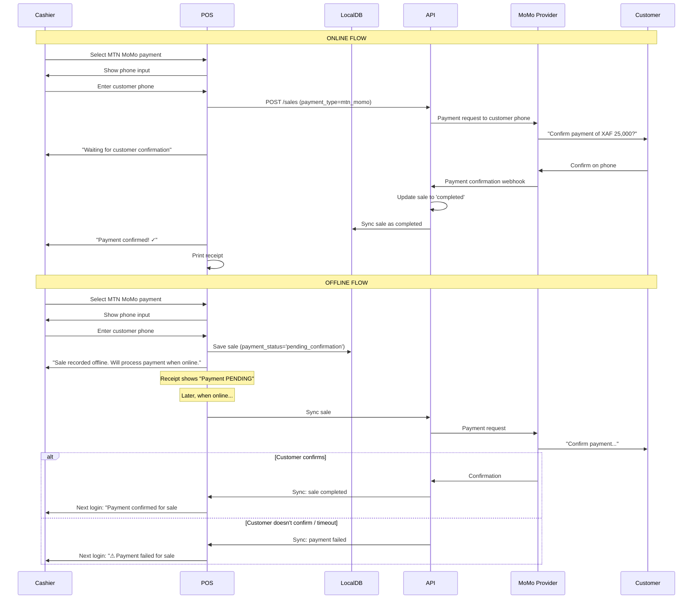

# UI/UX Flow — RetailGuard

## 1. Design Principles

1. **Offline-first by default** — Every screen must work without internet. Loading states never block the UI. Data is always served from the local database, and the sync indicator shows sync status persistently.
2. **Optimistic UI** — All user actions reflect immediately in the UI. The backend confirmation arrives asynchronously. Conflicts are surfaced non-disruptively.
3. **Role-appropriate interfaces** — Each role sees only the screens and actions they need. The POS screen for a cashier is streamlined; a branch manager sees additional management tools.
4. **Touch-first with keyboard shortcuts** — POS terminals are used in fast-paced environments. All primary actions are touch-friendly (large buttons, generous tap targets) and have keyboard shortcuts.
5. **Progressive disclosure** — Show the most critical information first. Advanced features (reports, settings) are behind navigation, not on the primary screen.
6. **Localized for Cameroon** — Currency (XAF), date formats, number formatting, and mobile money payment options are built-in defaults.

## 2. Screen Map

```mermaid
graph TD
    %% Root
    Login[Login Screen]
    
    %% Cashier Flow
    subgraph Cashier["Cashier Flow"]
        Pos[POS Screen]
        ShiftOpen[Open Shift]
        ShiftClose[Close Shift / Cash Declaration]
        Receipt[Receipt Preview]
        Expenses[Expense Entry]
        StockCheck[Stock Check]
    end
    
    %% Branch Manager Flow
    subgraph Manager["Branch Manager Flow"]
        M_Dashboard[Dashboard]
        M_Reports[Reports]
        M_Transfers[Transfer Approvals]
        M_Damages[Damage Approvals]
        M_Alerts[Fraud Alerts]
        M_Expenses[Expense Approvals]
        M_Staff[Staff Management]
        M_Reconciliation[Cash Reconciliation]
    end
    
    %% Warehouse Staff Flow
    subgraph Warehouse["Warehouse Staff Flow"]
        W_Stock[Stock View]
        W_Receive[Receive Transfers]
        W_Send[Send Transfers]
        W_Damage[Damage Reports]
        W_StockCount[Stock Count]
    end
    
    %% Admin Flow
    subgraph Admin["Admin Flow"]
        A_Dashboard[Analytics Dashboard]
        A_Branches[Branch Management]
        A_Products[Product & Price Mgmt]
        A_Users[User & Role Management]
        A_Fraud[Fraud Management]
        A_Settings[Tenant Settings]
        A_Audit[Audit Logs]
        A_Sync[Sync Health]
    end
    
    Login --> Pos
    Login --> M_Dashboard
    Login --> W_Stock
    Login --> A_Dashboard
    
    Pos --> ShiftOpen
    Pos --> ShiftClose
    Pos --> Receipt
    Pos --> Expenses
    Pos --> StockCheck
    
    M_Dashboard --> M_Reports
    M_Dashboard --> M_Transfers
    M_Dashboard --> M_Damages
    M_Dashboard --> M_Alerts
    M_Dashboard --> M_Expenses
    M_Dashboard --> M_Staff
    M_Dashboard --> M_Reconciliation
    
    W_Stock --> W_Receive
    W_Stock --> W_Send
    W_Stock --> W_Damage
    W_Stock --> W_StockCount
    
    A_Dashboard --> A_Branches
    A_Dashboard --> A_Products
    A_Dashboard --> A_Users
    A_Dashboard --> A_Fraud
    A_Dashboard --> A_Settings
    A_Dashboard --> A_Audit
    A_Dashboard --> A_Sync
```



## 3. Login Flow

### 3.1 Standard Login Screen

```
┌────────────────────────────────────┐
│  [RetailGuard Logo]                │
│                                    │
│  Email                              │
│  ┌──────────────────────────────┐  │
│  │ user@example.com              │  │
│  └──────────────────────────────┘  │
│                                    │
│  Password                           │
│  ┌──────────────────────────────┐  │
│  │ •••••••••••                   │  │
│  └──────────────────────────────┘  │
│                                    │
│  ┌──────────────────────────────┐  │
│  │         SIGN IN               │  │
│  └──────────────────────────────┘  │
│                                    │
│  [Connection Status Indicator]     │
│  [Version: 1.0.0]                  │
└────────────────────────────────────┘
```

**States:**

| State | Behavior |
|-------|----------|
| **Online, first login** | Full authentication against server. Device trust registration occurs after successful login. |
| **Online, returning user** | Authenticate against server. Refresh cached user data and offline token. |
| **Offline, previously logged in** | Authenticate against locally cached password hash. Device trust must be valid. Offline token issued locally. |
| **Offline, first time** | Show error: "First-time login requires an internet connection. Please connect to continue." |
| **Offline, device not trusted** | Show error: "This device is not trusted for offline access. Please log in online first to trust this device." |
| **Credentials expired** | Show "Your password has expired. Please change it." with link to settings (online required). |

### 3.2 Offline Login Flow (Technical)

```
User enters credentials
        │
        ▼
  ┌─────────────┐
  │ Is online?  │
  └─────┬───────┘
        │
   ┌────┴────┐
   │         │
  Yes       No
   │         │
   ▼         ▼
Server    ┌──────────────────────┐
auth     │ Look up user in local│
         │ SQLite by email      │
         └──────────┬───────────┘
                    │
                    ▼
         ┌──────────────────────┐
         │ User found & hashed  │
         │ password stored?     │
         └──────────┬───────────┘
                    │
              ┌─────┴──────┐
              │            │
             Yes           No
              │            │
              ▼            ▼
      ┌──────────────┐  Show: "Can't
      │ Verify bcrypt │  authenticate
      │ hash locally  │  offline. First
      └──────┬───────┘  login requires
             │           internet."
        ┌────┴────┐
        │         │
       Match    No Match
        │         │
        ▼         ▼
  ┌──────────┐  Show: "Invalid
  │ Check    │  credentials"
  │ device   │  + increment
  │ trust    │  local attempt
  └────┬─────┘  counter
       │
  ┌────┴────┐
  │         │
 Trusted  Not Trusted
   │         │
   ▼         ▼
Generate    Show: "Device
offline     not trusted for
token       offline access."
(Ed25519
 signed)
   │
   ▼
Load POS interface
(offline mode badge)
```

### 3.3 Post-Login Landing

| Role | Landing Screen | Rationale |
|------|---------------|-----------|
| Cashier | POS Screen (if shift open) or Open Shift prompt | Cashiers spend most time on POS |
| Supervisor | POS Screen | Supervisors also process sales |
| Manager | Dashboard | Managers need overview first |
| Warehouse Staff | Stock View | Primary tool for warehouse work |
| Admin | Analytics Dashboard | Admin needs system-wide view |

## 4. POS Screen (Cashier)

### 4.1 Layout

```
┌─────────────────────────────────────────────────────────────────────────────┐
│ ⏹ [Branch Name]  [Shift #12345 - Open]          🔴🔴🟢 [Sync Indicator] │
│ [Cashier: John Doe]                                            [≡ Menu]  │
├──────────────────┬──────────────────────────────────────────────────────────┤
│                  │                                                          │
│  PRODUCT GRID    │                    CART                                  │
│  ┌──┐ ┌──┐ ┌──┐ │  ┌──────────────────────────────────────────────────┐  │
│  │Ti│ │Ce│ │Gr│ │  │ Qty  Product              Price    Total   [×]  │  │
│  │le│ │ra│ │ou│ │  │ ──────────────────────────────────────────────── │  │
│  │ A│ │mi│ │t  │ │  │  3   Ceramic Tile 60x60   15,000  45,000  [×]  │  │
│  └──┘ └──┘ └──┘ │  │  2   Cement 50kg           5,500  11,000  [×]  │  │
│  ┌──┐ ┌──┐ ┌──┐ │  │  5   Paint White 20L       8,500  42,500  [×]  │  │
│  │Sa│ │Pa│ │Ac│ │  │  ──────────────────────────────────────────────── │  │
│  │ni│ │in│ │ce│ │  │                                      Subtotal    98,500│
│  │ta│ │t │ │ss│ │  │                                    Discount         0│
│  │ry│ │  │ │or│ │  │                                    VAT 19.25%  18,961│
│  └──┘ └──┘ └──┘ │  │ ┌────────────────────────────────────────────────┐ │
│  ┌──┐ ┌──┐ ┌──┐ │  │ │           TOTAL           XAF 117,461         │ │
│  │Ad│ │Pl│ │To│ │  │ └────────────────────────────────────────────────┘ │
│  │he│ │um│ │ol│ │  │                                                      │
│  │si│ │be│ │s │ │  │  ┌──────────┐ ┌──────────┐ ┌──────────┐ ┌────────┐ │
│  │ve│ │r │ │  │ │  │  │   CASH   │ │ MTN MOMO │ │ ORANGE   │ │ BANK   │ │
│  └──┘ └──┘ └──┘ │  │  │          │ │          │ │  MONEY   │ │TRANSFER│ │
│  ┌──┐ ┌──┐ ┌──┐ │  │  └──────────┘ └──────────┘ └──────────┘ └────────┘ │
│  │Si│ │Fl│ │Po│ │  │  ┌──────────┐ ┌──────────┐                         │
│  │nk│ │oo│ │ly│ │  │  │   MIXED  │ │  VOID    │                         │
│  │  │ │r │ │  │ │  │  │          │ │  SALE    │                         │
│  └──┘ └──┘ └──┘ │  │  └──────────┘ └──────────┘                         │
│                  │  │  [Clear Cart]               [Hold Sale]            │
│  [🔍 Search...]  │                                                       │
├──────────────────┴──────────────────────────────────────────────────────────┤
│ [Quick: F1=Search F2=Barcode F3=Repeat F4=Discount F5=Quantity F6=Pay]    │
└─────────────────────────────────────────────────────────────────────────────┘
```

### 4.2 Product Search

**Product search behavior:**
- **Primary:** Search by barcode (scanner). Auto-selects if single match.
- **Secondary:** Search by name, SKU, or brand. Results shown as user types (debounced 200ms).
- **Tertiary:** Category browsing via grid. Products cached offline.
- No internet query — all product data is from local SQLite.

```typescript
interface ProductSearchResult {
  id: string;
  sku: string;
  barcode: string;
  name: string;
  brand: string;
  category: string;
  stock_unit: string;
  available_quantity: number;
  prices: Array<{
    unit: string;
    selling_price: number;
    min_price: number;
    is_promotional: boolean;
  }>;
  image_url?: string;
}
```

**Search flow:**
```
User types 3+ characters → debounce 200ms → search local SQLite
  → show results in dropdown overlay
  → user taps result → auto-select unit → add to cart
```

**Barcode scan flow:**
```
Scanner sends barcode → search local SQLite by barcode
  → single match → auto-add to cart with default unit
  → multiple matches (rare, same barcode on variants) → show picker
  → no match → "Product not found" toast
```

### 4.3 Cart Operations

| Action | UX Behavior | Offline Behavior |
|--------|-------------|-----------------|
| **Add item** | Item appears in cart immediately with quantity 1 (or last used quantity). | Works fully offline — data from local SQLite. |
| **Change quantity** | Tap quantity cell → numeric keypad. Press Enter → cart updates total. | Works fully offline. |
| **Change unit** | Tap unit cell → unit picker (e.g., BOX/SQM). Price recalculated via conversion factor. | Works fully offline. |
| **Apply line discount** | Tap discount cell → enter discount amount or percentage. Shows remaining discount budget. | Works offline. Flagged for fraud if excessive. |
| **Remove item** | Swipe left or tap × → item removed with undo toast (3s). | Works offline. |
| **Clear cart** | Tap "Clear Cart" → confirmation dialog: "Clear all items?" → Yes/No. | Works offline. |
| **Hold sale** | Saves cart state to local DB. Cart can be recalled later. | Works offline. |
| **Recall held sale** | Shows list of held sales. Tap to load into cart. | Works offline. |

### 4.4 Payment Flow

#### Cash Payment

```
User taps "CASH"
  → Modal: Enter Amount Received
      ┌────────────────────────────────────┐
      │       CASH PAYMENT                 │
      │                                    │
      │  Total Due: XAF 117,461            │
      │                                    │
      │  Amount Received                    │
      │  ┌──────────────────────────────┐  │
      │  │ XAF  120,000                  │  │
      │  └──────────────────────────────┘  │
      │                                    │
      │  Change Due: XAF 2,539             │
      │                                    │
      │  ┌──────────┐  ┌──────────┐       │
      │  │  CANCEL   │  │ CONFIRM  │       │
      │  └──────────┘  └──────────┘       │
      │                                    │
      │  Quick amounts:                    │
      │  [100,000] [105,000] [120,000]     │
      │  [150,000] [200,000] [Exact]       │
      └────────────────────────────────────┘
  
  User confirms → Sale saved locally → Receipt printed → Cart cleared
  → Sync queued
```

#### Mobile Money (MTN MoMo / Orange Money)

```
User taps "MTN MOMO"
  → Modal: Mobile Money Payment
      ┌────────────────────────────────────┐
      │       MTN MoMo Payment             │
      │                                    │
      │  Total Due: XAF 117,461            │
      │                                    │
      │  Customer Phone                     │
      │  ┌──────────────────────────────┐  │
      │  │ 237 6XX XXX XXX               │  │
      │  └──────────────────────────────┘  │
      │                                    │
      │  ┌──────────────────────────────┐  │
      │  │        REQUEST PAYMENT        │  │
      │  └──────────────────────────────┘  │
      │                                    │
      │  Status: Waiting for customer to   │
      │  confirm on their phone...         │
      │  [⏳] Timeout: 45 seconds           │
      │                                    │
      │  ┌──────────┐  ┌──────────┐       │
      │  │  CANCEL   │  │  DONE -  │       │
      │  │           │  │ CONFIRMED│       │
      │  └──────────┘  └──────────┘       │
      └────────────────────────────────────┘

**Online behavior:**
1. Send payment request to mobile money provider API
2. Show "Waiting for customer confirmation" with 60-second timeout
3. On confirmation webhook → sale completes → receipt printed
4. On timeout → "Payment not confirmed. Sale saved as pending."

**Offline behavior:**
1. Sale created with `payment_status = 'pending_confirmation'`
2. No payment request sent to provider
3. Receipt shows "Payment PENDING — sale will complete once online"
4. On sync → payment request sent → result applied
5. If payment fails after sync → sale flagged, cashier notified
```

#### Bank Transfer

```
User taps "BANK TRANSFER"
  → Modal:
      ┌────────────────────────────────────┐
      │       BANK TRANSFER                 │
      │                                    │
      │  Total Due: XAF 117,461            │
      │                                    │
      │  Bank Account:                      │
      │  Account: RG-XXXX-XXXX-XXXX        │
      │  Name: RetailGuard Payments         │
      │  Bank: Afriland First Bank          │
      │                                    │
      │  Reference Number                    │
      │  ┌──────────────────────────────┐  │
      │  │ TRF-20260718-XXXX             │  │
      │  └──────────────────────────────┘  │
      │                                    │
      │  ┌──────────┐  ┌──────────┐       │
      │  │  CANCEL   │  │ CONFIRM  │       │
      │  └──────────┘  └──────────┘       │
      │                                    │
      │  Note: Sale recorded as pending    │
      │  until bank transfer is confirmed. │
      └────────────────────────────────────┘
```

#### Mixed Payment

```
User taps "MIXED" → Add multiple payment types
  Total: 117,461
  ┌────────────────────────────────────────┐
  │ Payment 1: Cash         XAF 80,000     │
  │ Payment 2: MTN MoMo     XAF 37,461     │
  │                                         │
  │ Remaining: XAF 0                        │
  │                                         │
  │ [+ Add Payment]                         │
  │                                         │
  │ [Cancel]  [Complete Sale]               │
  └────────────────────────────────────────┘
```

### 4.5 Receipt

After sale completion, the receipt is shown on screen and printed:

```
┌──────────────────────────────────┐
│     RETAILGUARD — BRANCH NAME    │
│   Address: 123 Rue, Douala        │
│   Tel: +237 6XX XXX XXX          │
│   Tax ID: XXXXXXXX                │
├──────────────────────────────────┤
│   RECEIPT                         │
│   # RCP-20260718-0042             │
│   Date: 18 Jul 2026 12:30        │
│   Cashier: John Doe               │
├──────────────────────────────────┤
│   Qty  Item          Total       │
│   ─────────────────────────────  │
│   3    Ceramic Tile   45,000     │
│   2    Cement         11,000     │
│   5    Paint White    42,500     │
├──────────────────────────────────┤
│   Subtotal             98,500    │
│   Discount                  0    │
│   VAT 19.25%           18,961    │
│   TOTAL               117,461    │
├──────────────────────────────────┤
│   Paid: Cash           120,000   │
│   Change:                2,539   │
│                                  │
│   Payment Status: COMPLETED      │
│   ---                            │
│   Thank you for your business!   │
│   Returns accepted within 7 days │
│   with original receipt.         │
└──────────────────────────────────┘
```

**Receipt states:**

| State | Display |
|-------|---------|
| Completed | Full receipt with payment confirmed |
| Pending (MoMo) | "Payment PENDING. Sale will complete once payment is confirmed." plus QR code |
| Offline | "Recorded OFFLINE. Will sync when online." plus "Pending" watermark |
| Voided | "VOID" watermark across entire receipt |

## 5. Shift Management

### 5.1 Open Shift

```
Screen shown when cashier with no open shift accesses POS:

┌────────────────────────────────────┐
│  OPEN NEW SHIFT                     │
│                                     │
│  Branch: Douala Main (Branch)       │
│  Cashier: John Doe                  │
│                                     │
│  Opening Balance                     │
│  ┌──────────────────────────────┐   │
│  │ XAF 50,000                    │   │
│  └──────────────────────────────┘   │
│                                     │
│  Notes (optional)                    │
│  ┌──────────────────────────────┐   │
│  │ Morning shift                  │   │
│  └──────────────────────────────┘   │
│                                     │
│  Cash Breakdown (optional):          │
│  10,000 × [5] = 50,000             │
│  5,000  × [0] = 0                  │
│  2,000  × [0] = 0                  │
│  1,000  × [0] = 0                  │
│  500    × [0] = 0                  │
│  100    × [0] = 0                  │
│  ─────────────────────────────      │
│  Total: XAF 50,000 ✓               │
│                                     │
│  ┌──────────┐  ┌──────────┐        │
│  │  CANCEL   │  │ OPEN     │        │
│  │           │  │ SHIFT    │        │
│  └──────────┘  └──────────┘        │
└────────────────────────────────────┘
```

**Offline behavior:** Shift opens entirely offline. Data saved to local SQLite. Synced on next connection.

**Validation:**
- Cannot open shift if another shift is already open for this cashier at this branch
- Opening balance must be ≥ 0
- Cash breakdown must sum to opening balance (warning, not blocking)

### 5.2 Close Shift / Cash Declaration

```
┌────────────────────────────────────┐
│  CLOSE SHIFT #12345                 │
│  Cashier: John Doe                  │
│  Opened: 18 Jul 2026 06:00         │
│  Duration: 8h 30m                   │
│                                     │
│  ┌──────────────┬──────────────┐   │
│  │ Sales Summary │              │   │
│  ├──────────────┼──────────────┤   │
│  │ Sale Count   │ 42           │   │
│  │ Total Sales  │ XAF 145,000  │   │
│  │ Cash Sales   │ XAF 120,000  │   │
│  │ MoMo Sales   │ XAF 25,000   │   │
│  │ Expenses     │ XAF 8,500    │   │
│  │ Discounts    │ XAF 3,200    │   │
│  │ Voids        │ XAF 0        │   │
│  └──────────────┴──────────────┘   │
│                                     │
│  Expected Cash: XAF 161,500         │
│  (Opening 50,000 + Cash Sales       │
│   120,000 - Expenses 8,500)         │
│                                     │
│  ── Declare Actual Cash ──          │
│  10,000 × [5] = 50,000             │
│  5,000  × [10] = 50,000            │
│  2,000  × [15] = 30,000            │
│  1,000  × [20] = 20,000            │
│  500    × [10] = 5,000             │
│  100    × [25] = 2,500             │
│  ─────────────────────────────      │
│  Declared Total: XAF 157,500        │
│                                     │
│  Discrepancy: XAF -4,000 (-2.48%)   │
│                                     │
│  ┌──────────────────────────────┐   │
│  │ Reason (if discrepancy)       │   │
│  │ Gave wrong change to customer  │   │
│  └──────────────────────────────┘   │
│                                     │
│  ┌──────────┐  ┌──────────────┐    │
│  │  CANCEL   │  │ REQUEST      │    │
│  │           │  │ SUPERVISOR   │    │
│  └──────────┘  │ CLOSE        │    │
│                └──────────────┘    │
└────────────────────────────────────┘
```

**Discrepancy handling:**

| Discrepancy | Behavior |
|-------------|----------|
| < 0.5% | Shift closes normally. Logged in audit. |
| 0.5%–2% | Supervisor approval required to close. Must enter reason. |
| 2%–5% | Supervisor approval + written explanation required. Fraud alert created (medium). |
| > 5% | Cannot close. Manager must investigate. Fraud alert created (high/critical). Flag for investigation. |

**Offline behavior:** Shift close is processed locally. Fraud detection runs locally for cash shortage. If discrepancy exceeds threshold, alert created locally and shift status set to `flagged`. Full evaluation happens on sync.

## 6. Inventory Screens

### 6.1 Stock View (Cashier / Warehouse)

```
┌──────────────────────────────────────┐
│  STOCK — Douala Main (Branch)        │
│                                      │
│  [🔍 Search products...]            │
│                                      │
│  ┌──────┬──────────┬──────┬────────┐ │
│  │ SKU  │ Product  │ Stock│ Reorder│ │
│  ├──────┼──────────┼──────┼────────┤ │
│  │ TILE │ Ceramic  │ 84.5 │ 50     │ │
│  │ -60  │ Tile      │ BOX  │ ✓      │ │
│  │      │ 60x60     │      │        │ │
│  ├──────┼──────────┼──────┼────────┤ │
│  │ CEM  │ Cement   │ 12   │ 20     │ │
│  │ -50  │ 50kg     │ BAGS │ ⚠ LOW  │ │
│  ├──────┼──────────┼──────┼────────┤ │
│  │ PNT  │ Paint    │ 3    │ 10     │ │
│  │ -WH  │ White    │ 20L  │ ⚠ LOW  │ │
│  │      │ 20L      │      │        │ │
│  └──────┴──────────┴──────┴────────┘ │
│                                      │
│  [Request Transfer] [Report Damage]  │
│  [Stock Count]                       │
└──────────────────────────────────────┘
```

**Stock data source:** Local SQLite `current_stock` materialized. Updated on every inventory movement and synced from server.

**Low stock indicators:**
- Yellow badge: quantity ≤ reorder_level
- Red badge: quantity ≤ reorder_level * 0.5
- Green badge: quantity > reorder_level

### 6.2 Transfer Request

```
┌────────────────────────────────────┐
│  REQUEST TRANSFER                   │
│                                     │
│  From: Warehouse - Main             │
│  To:   Douala Main (Branch)         │
│                                     │
│  ┌──────────────────────────────┐   │
│  │ Search products to add...     │   │
│  └──────────────────────────────┘   │
│                                     │
│  ┌──────────┬──────┬──────┬──────┐ │
│  │ Product  │ Stock│ Qty  │ Unit │ │
│  ├──────────┼──────┼──────┼──────┤ │
│  │ Ceramic  │ 200  │ 50   │ BOX  │ │
│  │ Tile     │ BOX  │      │      │ │
│  │ 60x60    │      │      │      │ │
│  ├──────────┼──────┼──────┼──────┤ │
│  │ Cement   │ 150  │ 30   │ BAG  │ │
│  │ 50kg     │ BAGS │      │      │ │
│  └──────────┴──────┴──────┴──────┘ │
│                                     │
│  Notes:                              │
│  ┌──────────────────────────────┐   │
│  │ Restock for weekend promo     │   │
│  └──────────────────────────────┘   │
│                                     │
│  ┌──────────┐  ┌──────────┐        │
│  │  CANCEL   │  │ SUBMIT   │        │
│  └──────────┘  └──────────┘        │
└────────────────────────────────────┘
```

**Offline behavior:** Transfer request created locally. Inventory movements created as `transfer_out` with `sync_status='pending'`. On sync, server processes the transfer. If source location has insufficient stock, transfer is rejected as a sync conflict.

### 6.3 Damage Report

```
┌────────────────────────────────────┐
│  REPORT DAMAGE                      │
│                                     │
│  Location: Douala Main (Branch)     │
│                                     │
│  Product                              │
│  ┌──────────────────────────────┐   │
│  │ Search product...            │   │
│  └──────────────────────────────┘   │
│                                     │
│  Quantity: [3] Unit: [BOX ▼]       │
│                                     │
│  Damage Type                         │
│  ┌──────────────────────────────┐   │
│  │ [Cracked ▼]                   │   │
│  └──────────────────────────────┘   │
│                                     │
│  Description                         │
│  ┌──────────────────────────────┐   │
│  │ Tiles cracked during          │   │
│  │ unloading from delivery truck │   │
│  └──────────────────────────────┘   │
│                                     │
│  Estimated Loss: XAF 45,000         │
│                                     │
│  Photos (optional): [📷 Add Photo]  │
│                                     │
│  ┌──────────┐  ┌──────────┐        │
│  │  CANCEL   │  │ SUBMIT   │        │
│  └──────────┘  └──────────┘        │
└────────────────────────────────────┘
```

**Offline behavior:** Damage report created locally. Photos stored as base64 in IndexedDB. Inventory movement (`damage_write_off`) created locally. Synced to server on next connection.

## 7. Expense Entry

```
┌────────────────────────────────────┐
│  RECORD EXPENSE                     │
│                                     │
│  Branch: Douala Main                │
│  Shift: #12345                      │
│                                     │
│  Category                             │
│  ┌──────────────────────────────┐   │
│  │ [Transport ▼]                 │   │
│  └──────────────────────────────┘   │
│                                     │
│  Amount                              │
│  ┌──────────────────────────────┐   │
│  │ XAF 5,000                     │   │
│  └──────────────────────────────┘   │
│                                     │
│  Description                         │
│  ┌──────────────────────────────┐   │
│  │ Customer delivery transport   │   │
│  └──────────────────────────────┘   │
│                                     │
│  Receipt Photo (optional):          │
│  [📷 Take Photo] [📁 Upload]       │
│                                     │
│  ┌──────────┐  ┌──────────┐        │
│  │  CANCEL   │  │  SAVE    │        │
│  └──────────┘  └──────────┘        │
└────────────────────────────────────┘
```

**Approval workflow:**
- If amount < 10,000 XAF → auto-approved (logged)
- If amount >= 10,000 XAF → requires manager approval
- If amount >= 50,000 XAF → requires regional manager approval
- Offline: expenses saved as `pending_approval`. Approval status updated on sync.

## 8. Branch Manager Dashboard

### 8.1 Main Dashboard

```
┌───────────────────────────────────────────────────────────┐
│  DASHBOARD — Douala Main                    [Jul 18, 2026] │
│  [Today ▼] [↻ Refresh] [📊 Full Report]                  │
├──────────────────┬──────────────────┬──────────────────────┤
│   TODAY'S KPI    │   BRANCH HEALTH  │   ALERTS             │
│  ┌──────────────┐│ ┌──────────────┐ │ ┌──────────────────┐│
│  │ Sales        ││ │ Sync Status  │ │ │ ⚠ 3 Fraud Alerts ││
│  │ XAF 145,000  ││ │ 🟢 All synced │ │ │   [View All]    ││
│  │ 42 transactions│ │              │ │ │                  ││
│  │ Avg: 3,452  ││ │ 📱 2 offline  │ │ │ ! 5 Pending      ││
│  └──────────────┘│ └──────────────┘ │ │   Approvals      ││
│  ┌──────────────┐│ ┌──────────────┐ │ └──────────────────┘│
│  │ Payment Split││ │ Stock Health │ │                      │
│  │ 🟦 Cash 67.6%││ │ 🟢 180 items │ │   QUICK ACTIONS     │
│  │ 🟩 MoMo 25.9%││ │ 🟡 12 low    │ │  [Approve Transfers]│
│  │ 🟧 Other 6.5%││ │ 🔴 3 critical │ │  [Approve Expenses] │
│  └──────────────┘│ └──────────────┘ │  [Review Damages]   │
│  ┌──────────────┐│ ┌──────────────┐ │  [Staff Schedule]   │
│  │ Top Products ││ │ Cash Health  │ │                      │
│  │ 1. Ceramic   ││ │ ✓ Reconciled │ │                      │
│  │    Tile      ││ │   Jul 17     │ │                      │
│  │ 2. Cement    ││ │              │ │                      │
│  │ 3. Paint     ││ │              │ │                      │
│  └──────────────┘│ └──────────────┘ │                      │
├──────────────────┴──────────────────┴──────────────────────┤
│  SALES TREND (Last 7 days)                                 │
│  ┌──────────────────────────────────────────────────────┐ │
│  │  ██                                                    │ │
│  │  ██ ██                                                 │ │
│  │  ██ ██ ██                                              │ │
│  │  ██ ██ ██ ██ ██                                        │ │
│  │  ██ ██ ██ ██ ██ ██ ██                                  │ │
│  │  Mon Tue Wed Thu Fri Sat Sun                            │ │
│  └──────────────────────────────────────────────────────┘ │
└───────────────────────────────────────────────────────────┘
```

### 8.2 Fraud Alerts View

```
┌─────────────────────────────────────┐
│  FRAUD ALERTS — Douala Main          │
│  [All Types ▼] [All Severity ▼]     │
│  [Open Only]                         │
├─────────────────────────────────────┤
│  ┌─────────────────────────────────┐│
│  │ 🔴 CRITICAL │ Cash Shortage    ││
│  │ Score: 82   │ 18 min ago       ││
│  │ Branch: Douala Main            ││
│  │ Cashier: John Doe (Shift #12345)││
│  │ Discrepancy: XAF -45,000 (-4.2%)││
│  │ [Assign] [Investigate]         ││
│  └─────────────────────────────────┘│
│  ┌─────────────────────────────────┐│
│  │ 🟡 MEDIUM   │ Suspicious       ││
│  │ Score: 42   │ 2h ago           ││
│  │ Branch: Douala Main            ││
│  │ Pattern: Pre-shift-end flurry  ││
│  │ 8 offline sales in last 30 min ││
│  │ [Assign] [Investigate]         ││
│  └─────────────────────────────────┘│
│  ┌─────────────────────────────────┐│
│  │ 🟢 LOW      │ Frequent Voids   ││
│  │ Score: 18   │ 4h ago           ││
│  │ 6 voids today (14.3% rate)     ││
│  │ [Assign] [Investigate]         ││
│  └─────────────────────────────────┘│
│  ┌─────────────────────────────────┐│
│  │ 📄 RESOLVED │ Price Override   ││
│  │ False positive - customer       ││
│  │ loyalty discount approved       ││
│  └─────────────────────────────────┘│
└─────────────────────────────────────┘
```

## 9. Admin Analytics Dashboard

### 9.1 Top-Level KPIs

```
┌───────────────────────────────────────────────────────────────────────────┐
│  ANALYTICS — All Branches                    [Jul 2026 ▼] [Custom Date]   │
├──────────┬──────────┬──────────┬──────────┬──────────┬──────────┬─────────┤
│  Revenue │  Orders  │ Avg Order│ Expenses │ Discounts│  Voids   │ Margin │
│ XAF 3.2M │  843     │ XAF 3.8K │ XAF 185K │ XAF 52K  │ XAF 18K  │ 32.5%  │
│ ▲ 12.3%  │ ▲ 8.1%   │ ▲ 3.9%   │ ▼ -2.1%  │ ▲ 5.4%   │ ▼ -8.2%  │ ▲ 1.2% │
├──────────┴──────────┴──────────┴──────────┴──────────┴──────────┴─────────┤
│  CHARTS SECTION                                                            │
│  ┌──────────────────────────┐ ┌──────────────────────────┐                │
│  │  Revenue by Branch       │ │  Payment Methods         │                │
│  │  [Bar chart]             │ │  [Pie chart]             │                │
│  └──────────────────────────┘ └──────────────────────────┘                │
│  ┌──────────────────────────┐ ┌──────────────────────────┐                │
│  │  Daily Sales Trend       │ │  Top 10 Products         │                │
│  │  [Line chart]            │ │  [Horizontal bar chart]  │                │
│  └──────────────────────────┘ └──────────────────────────┘                │
│  ┌──────────────────────────┐ ┌──────────────────────────┐                │
│  │  Fraud Alerts Trend     │ │  Sync Health             │                │
│  │  [Stacked area chart]   │ │  [Status indicators]     │                │
│  └──────────────────────────┘ └──────────────────────────┘                │
└───────────────────────────────────────────────
```

### 9.2 Report Types

| Report | Description | Export Formats |
|--------|-------------|----------------|
| Sales Summary | Daily/weekly/monthly sales by branch, cashier, payment type | PDF, CSV, XLSX |
| Inventory Movement | All movements by product, location, type | PDF, CSV |
| Cash Reconciliation | Shift-by-shift cash reconciliation with discrepancies | PDF, CSV |
| Expense Report | Expenses by category, branch, approval status | CSV, XLSX |
| Fraud Report | All fraud alerts with resolution status | PDF, CSV |
| Sync Health Report | Device sync status, latency, failure rates | CSV |
| Audit Log | All system events with filters | CSV |

## 10. Sync Indicator

The sync indicator is persistently visible in the header/footer on every screen.

```
┌─────────────────────────────────┐
│ States:                         │
│ 🟢 All synced     ✓ 2 min ago  │
│ 🟡 Syncing...     ⟳ 23 of 45   │
│ 🟠 Pending sync   ⏳ 45 items   │
│ 🔴 Sync failed    ✗ 3 failed    │
│ 🔵 Offline mode    [no internet] │
│ ⚪ Never synced    [new device]  │
└─────────────────────────────────┘
```

**Tapping the indicator** opens the sync detail panel:

```
┌─────────────────────────────────┐
│  SYNC STATUS                     │
│                                 │
│  Device: POS Terminal #1        │
│  Branch: Douala Main            │
│                                 │
│  Online: ✅ Connected            │
│  Last Sync: 2 min ago           │
│                                 │
│  ┌─────────────────────────┐    │
│  │ Pending Upload: 0 items │    │
│  │ Pending Download: 5     │    │
│  │ Conflicts: 0            │    │
│  │ Failed: 1 ▼             │    │
│  │  · Sale #0041: network  │    │
│  │    timeout [Retry]      │    │
│  └─────────────────────────┘    │
│                                 │
│  [Sync Now] [View Full Log]     │
└─────────────────────────────────┘
```

## 11. Navigation Model

### 11.1 POS Terminal Navigation (Cashier)

```
Bottom Navigation (always visible):
┌──────────┬──────────┬──────────┬──────────┬──────────┐
│   💳 POS │ 📦 Stock│ 💰 Shift │ 📋 Rep.  │ ⚙ More   │
└──────────┴──────────┴──────────┴──────────┴──────────┘

"More" menu:
┌────────────────────┐
│  Expenses           │
│  Transfers          │
│  Damages            │
│  Settings           │
│  Logout             │
└────────────────────┘
```

### 11.2 Admin Dashboard Navigation

```
Top navigation:
[RetailGuard Logo]  [Dashboard] [Branches] [Products] [Users] [Fraud] [Settings]
                                                                      [Admin Name ▼]

Side panel (expandable):
┌────────────────┐
│ 📊 Dashboard    │
│ 🏪 Branches     │
│ 📦 Products     │
│ 👥 Users        │
│ 🚨 Fraud        │
│ 📋 Reports      │
│ 📝 Audit Log    │
│ 🔄 Sync Health  │
│ ⚙ Settings      │
│ 🚪 Logout       │
└────────────────┘
```

## 12. Optimistic UI Patterns

### 12.1 What Users See Immediately vs. After Sync

| Action | Immediate UI | After Sync |
|--------|-------------|------------|
| Create sale | Sale appears in recent sales, inventory deducted, receipt printed | Server version assigned, sync status becomes green |
| Close shift | Shift summary shown with local discrepancy | Server validates, may update discrepancy if server-side fraud rules hit |
| Record expense | Expense shown in shift summary, deducted from expected cash | Approval status updated, may be rejected by manager |
| Report damage | Stock reduced locally, damage report listed | Server creates official movement, may adjust if conflict |
| Create transfer | Transfer shown as "pending" | Server validates stock, approves/rejects |
| Change price | Price updated locally for next sale | Admin must approve price changes (reverted if rejected) |

### 12.2 Conflict Resolution UI

When a sync conflict occurs, the cashier sees a notification:

```
┌────────────────────────────────────┐
│  ⚠ SYNC CONFLICT                    │
│                                     │
│  Sale #0041 could not be synced.    │
│                                     │
│  Reason: Price changed while offline │
│  Sale price: 8,500 XAF per BOX      │
│  Current price: 9,500 XAF per BOX   │
│                                     │
│  ┌──────────┐  ┌──────────────┐    │
│  │  KEEP     │  │ USE SERVER   │    │
│  │  MY PRICE │  │ PRICE        │    │
│  └──────────┘  └──────────────┘    │
│  ┌──────────────────────────────┐  │
│  │ Send to supervisor for review│  │
│  └──────────────────────────────┘  │
└────────────────────────────────────┘
```

### 12.3 Loading States

RetailGuard never shows a blank loading screen. Every screen has a meaningful cached/default state:

| Situation | UX |
|-----------|-----|
| First load (no cache) | Skeleton layout with pulse animation |
| Cache available | Show cached data immediately with "Last synced: X min ago" badge |
| Pull-to-refresh | Spinner overlay, existing data remains visible |
| Sync in background | Sync indicator animates, no UI blocking |
| Network reconnects | Brief toast: "Connected. Syncing..." |
| Offline transaction | Subtle offline badge on receipt, no disruption |

## 13. Mobile Money Flow (Detailed)



## 14. Error States

| Error | UI Treatment |
|-------|-------------|
| Network unavailable | Persistent offline badge in header. No modals or disruptive alerts. |
| Validation error (form) | Inline error below the field with red border. |
| Server error on sync | Sync indicator turns red. Failed items listed in sync detail panel. |
| Insufficient stock | Modal: "⚠ Insufficient stock. Available: 5 BOX. Requested: 10 BOX." |
| Payment timeout | Modal: "⏱ Payment not confirmed. Sale saved as pending." |
| Printer not connected | Toast: "🖨 Printer not found. Receipt can be re-printed from sale history." |
| Scanner not working | Toast: "📷 Scanner disconnected. You can still search manually." |
| Database error (local) | Error boundary screen: "Something went wrong. Please restart the app. [Restart]" |
| Session expired | Modal: "Your session has expired. Please log in again." → Login screen |

## 15. Accessibility & Usability

1. **High contrast mode** for outdoor/bright retail environments (POS terminals near windows)
2. **Font size scaling** — all text uses relative units
3. **Keyboard navigation** — full tab order with visible focus indicators
4. **Screen reader support** — aria labels on all interactive elements
5. **Touch targets** — minimum 44x44px for all tappable elements
6. **Error prevention** — confirmation dialogs for destructive actions (void, clear cart, close shift)
7. **Undo support** — 5-second undo toast for item removal from cart
8. **Reduced motion** — respects `prefers-reduced-motion` for animations
