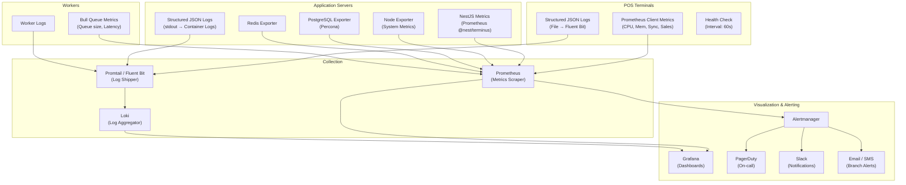

# Monitoring & Observability — RetailGuard

## 1. Design Principles

1. **Offline-first observability** — The status of offline POS terminals and their sync health is as important as server health. Monitoring must work for devices that are intermittently connected.
2. **Business metrics are first-class** — Beyond system health, monitoring must track retail-specific KPIs: sales per branch, cash reconciliation accuracy, inventory accuracy, fraud alerts.
3. **Actionable alerting** — Every alert has a clear severity, a defined owner, and a documented runbook. Alerts that don't trigger action are noise and get removed.
4. **Role-appropriate dashboards** — A branch manager should not see Kubernetes pod status. An admin should not see per-cashier void rates unless drilling down. Dashboards are designed per persona.
5. **Cost-conscious** — As a startup targeting price-sensitive markets, monitoring must be cost-effective. The initial stack uses the Grafana Cloud free tier, self-hosted Prometheus, and structured JSON logging to a local Loki instance.

## 2. Monitoring Stack



**Initial stack (free tier):**
- **Prometheus** (self-hosted on VPS) — metrics collection
- **Loki** (self-hosted on VPS) — log aggregation
- **Promtail** (sidecar on each container) — log shipping
- **Grafana** (self-hosted or Grafana Cloud free tier) — dashboards
- **Alertmanager** (self-hosted) — alert routing
- **Node Exporter** (on each VPS) — system metrics
- **PostgreSQL Exporter** (Percona) — database metrics
- **Redis Exporter** — cache/queue metrics

**Scaled stack (50+ branches):**
- Grafana Cloud Pro ($30/mo) — managed dashboards + alerting
- Loki logs retention increased to 30 days
- Synthetic monitoring with Grafana Cloud checks

**Why not Datadog or New Relic:**
- Cost: $15–$30/host/month adds up quickly for 10+ servers
- Complexity: SaaS APM adds overhead for a team that needs simplicity
- Bandwidth: Sending full traces from Cameroon over limited bandwidth is not practical
- The open-source stack (Prometheus + Loki + Grafana) is well-proven and sufficient for this scale

## 3. System Metrics

### 3.1 Infrastructure Metrics (Prometheus + Node Exporter)

| Metric | Source | Warning | Critical | Frequency |
|--------|--------|---------|----------|-----------|
| CPU utilization | Node Exporter | > 80% for 5 min | > 90% for 5 min | 15s |
| Memory utilization | Node Exporter | > 80% | > 90% | 15s |
| Disk usage (data) | Node Exporter | > 75% | > 85% | 60s |
| Disk usage (WAL) | Node Exporter | > 60% | > 75% | 60s |
| Disk I/O latency | Node Exporter | > 100ms avg | > 500ms avg | 15s |
| Network bandwidth | Node Exporter | > 80% of capacity | > 95% of capacity | 15s |
| Load average | Node Exporter | > 2x CPU cores | > 4x CPU cores | 15s |
| TCP connection count | Node Exporter | > 1000 | > 5000 | 30s |
| Swap usage | Node Exporter | > 10% | > 25% | 30s |

### 3.2 Container Metrics (Prometheus + cAdvisor)

| Metric | Warning | Critical | Notes |
|--------|---------|----------|-------|
| Container OOM kills | Any | Any | Immediate alert |
| Container restart count | > 3 in 1 hour | > 5 in 1 hour | Restart loop |
| Container CPU throttling | > 20% throttled | > 50% throttled | Increase CPU limits |
| Container memory usage | > 80% of limit | > 95% of limit | Increase memory limits |

### 3.3 Prometheus Configuration

```yaml
# /etc/prometheus/prometheus.yml
global:
  scrape_interval: 15s
  evaluation_interval: 15s
  external_labels:
    environment: 'production'

scrape_configs:
  - job_name: 'node'
    static_configs:
      - targets:
          - 'node-exporter:9100'
        labels:
          role: 'vps'

  - job_name: 'postgresql'
    static_configs:
      - targets:
          - 'postgres-exporter:9187'
        labels:
          service: 'postgresql'

  - job_name: 'redis'
    static_configs:
      - targets:
          - 'redis-exporter:9121'
        labels:
          service: 'redis'

  - job_name: 'api'
    metrics_path: '/api/v1/metrics'
    static_configs:
      - targets:
          - 'api:3000'
        labels:
          service: 'api'

  - job_name: 'sync-worker'
    static_configs:
      - targets:
          - 'sync-worker:9090'
        labels:
          service: 'sync-worker'

  - job_name: 'fraud-worker'
    static_configs:
      - targets:
          - 'fraud-worker:9090'
        labels:
          service: 'fraud-worker'

  # Pushgateway for POS terminal metrics (pushed from terminals)
  - job_name: 'pos-terminals'
    honor_labels: true
    static_configs:
      - targets:
          - 'pushgateway:9091'
        labels:
          service: 'pos-terminal'
```

## 4. Application Metrics

### 4.1 API Metrics (NestJS + @nestjs/terminus)

```typescript
// apps/api/src/common/metrics/metrics.service.ts
import { Injectable, OnModuleInit } from '@nestjs/common';
import { Counter, Histogram, Gauge } from 'prom-client';

@Injectable()
export class MetricsService implements OnModuleInit {
  // HTTP request metrics
  private httpRequestDuration: Histogram<string>;
  private httpRequestTotal: Counter<string>;
  private httpRequestErrors: Counter<string>;

  // Sync metrics
  private syncBatchSize: Histogram<string>;
  private syncBatchDuration: Histogram<string>;
  private syncConflictsTotal: Counter<string>;
  private syncPushTotal: Counter<string>;
  private syncPullTotal: Counter<string>;

  // Business metrics
  private salesCreatedTotal: Counter<string>;
  private salesVoidedTotal: Counter<string>;
  private salesAmountTotal: Counter<string>;
  private fraudAlertsTotal: Counter<string>;
  private shiftDiscrepancyTotal: Gauge<string>;

  // Database metrics
  private dbQueryDuration: Histogram<string>;
  private dbConnectionsActive: Gauge<string>;
  private dbPoolAvailable: Gauge<string>;

  // Queue metrics
  private queueSize: Gauge<string>;
  private queueLatency: Histogram<string>;
  private queueFailedJobs: Counter<string>;

  onModuleInit() {
    this.httpRequestDuration = new Histogram({
      name: 'retailguard_http_request_duration_ms',
      help: 'HTTP request duration in milliseconds',
      labelNames: ['method', 'route', 'status_code'],
      buckets: [10, 25, 50, 100, 250, 500, 1000, 2500, 5000],
    });

    this.httpRequestTotal = new Counter({
      name: 'retailguard_http_requests_total',
      help: 'Total HTTP requests',
      labelNames: ['method', 'route', 'status_code'],
    });

    this.httpRequestErrors = new Counter({
      name: 'retailguard_http_request_errors_total',
      help: 'HTTP request errors (4xx/5xx)',
      labelNames: ['method', 'route', 'error_code'],
    });

    this.syncBatchSize = new Histogram({
      name: 'retailguard_sync_batch_size',
      help: 'Number of records in sync batch',
      labelNames: ['direction'], // 'push' or 'pull'
      buckets: [1, 5, 10, 25, 50, 100, 200, 500],
    });

    this.syncBatchDuration = new Histogram({
      name: 'retailguard_sync_batch_duration_ms',
      help: 'Sync batch processing duration in milliseconds',
      labelNames: ['direction'],
      buckets: [50, 100, 250, 500, 1000, 2500, 5000, 10000],
    });

    this.syncConflictsTotal = new Counter({
      name: 'retailguard_sync_conflicts_total',
      help: 'Total sync conflicts detected',
      labelNames: ['conflict_type', 'table'],
    });

    this.syncPushTotal = new Counter({
      name: 'retailguard_sync_push_total',
      help: 'Total sync push operations',
      labelNames: ['status'], // 'success', 'partial', 'failed'
    });

    this.syncPullTotal = new Counter({
      name: 'retailguard_sync_pull_total',
      help: 'Total sync pull operations',
      labelNames: ['status'],
    });

    this.salesCreatedTotal = new Counter({
      name: 'retailguard_sales_created_total',
      help: 'Total sales created',
      labelNames: ['branch_id', 'payment_type'],
    });

    this.salesVoidedTotal = new Counter({
      name: 'retailguard_sales_voided_total',
      help: 'Total sales voided',
      labelNames: ['branch_id'],
    });

    this.salesAmountTotal = new Counter({
      name: 'retailguard_sales_amount_total_xaf',
      help: 'Total sales amount in XAF',
      labelNames: ['branch_id'],
    });

    this.fraudAlertsTotal = new Counter({
      name: 'retailguard_fraud_alerts_total',
      help: 'Total fraud alerts generated',
      labelNames: ['severity', 'alert_type'],
    });

    this.shiftDiscrepancyTotal = new Gauge({
      name: 'retailguard_shift_discrepancy_amount_xaf',
      help: 'Cash discrepancy amount per shift (negative = shortage, positive = surplus)',
      labelNames: ['branch_id'],
    });

    this.dbQueryDuration = new Histogram({
      name: 'retailguard_db_query_duration_ms',
      help: 'Database query duration in milliseconds',
      labelNames: ['query_type', 'table'],
      buckets: [1, 5, 10, 25, 50, 100, 250, 500, 1000],
    });

    this.dbConnectionsActive = new Gauge({
      name: 'retailguard_db_connections_active',
      help: 'Active database connections',
      labelNames: ['pool'], // 'primary' or 'replica'
    });

    this.queueSize = new Gauge({
      name: 'retailguard_queue_size',
      help: 'Bull queue size',
      labelNames: ['queue_name'],
    });

    this.queueLatency = new Histogram({
      name: 'retailguard_queue_job_latency_ms',
      help: 'Time a job spent waiting in the queue before processing',
      labelNames: ['queue_name'],
      buckets: [10, 50, 100, 500, 1000, 5000, 10000, 30000],
    });
  }

  /** Record HTTP request metrics (called from interceptor) */
  recordHttpRequest(method: string, route: string, statusCode: number, durationMs: number): void {
    this.httpRequestDuration.observe({ method, route, status_code: statusCode.toString() }, durationMs);
    this.httpRequestTotal.inc({ method, route, status_code: statusCode.toString() });

    if (statusCode >= 400) {
      this.httpRequestErrors.inc({ method, route, error_code: statusCode.toString() });
    }
  }

  /** Record sync batch metrics */
  recordSyncBatch(direction: 'push' | 'pull', recordCount: number, durationMs: number, status: string): void {
    this.syncBatchSize.observe({ direction }, recordCount);
    this.syncBatchDuration.observe({ direction }, durationMs);

    if (direction === 'push') {
      this.syncPushTotal.inc({ status });
    } else {
      this.syncPullTotal.inc({ status });
    }
  }

  /** Record a new sale */
  recordSale(branchId: string, paymentType: string, amount: number): void {
    this.salesCreatedTotal.inc({ branch_id: branchId, payment_type: paymentType });
    this.salesAmountTotal.inc({ branch_id: branchId }, amount / 100); // Histogram in units of 100 XAF
  }
}
```

### 4.2 POS Terminal Metrics

```typescript
// apps/pos/src/main/metrics-collector.ts
export class PosMetricsCollector {
  private readonly pushInterval: number = 60000; // Push metrics every 60s

  async start(): Promise<void> {
    setInterval(() => this.pushMetrics(), this.pushInterval);
  }

  private async pushMetrics(): Promise<void> {
    const metrics = {
      // System
      cpu_usage: await this.getCpuUsage(),
      memory_usage: process.memoryUsage().heapUsed / process.memoryUsage().heapTotal,
      uptime_seconds: process.uptime(),

      // App state
      is_online: navigator.onLine ? 1 : 0,
      app_version: app.getVersion(),
      database_size_mb: await this.getDatabaseSize(),

      // Sync health
      pending_sync_count: await this.getPendingSyncCount(),
      failed_sync_count: await this.getFailedSyncCount(),
      last_sync_success_timestamp: (await this.getLastSyncTime())?.getTime() || 0,
      sync_conflicts_count: await this.getSyncConflictCount(),
      consecutive_sync_failures: await this.getConsecutiveSyncFailures(),

      // Sales today
      sales_today_count: await this.getSalesTodayCount(),
      sales_today_amount_xaf: await this.getSalesTodayAmount(),
      shift_status: await this.getShiftStatus(), // 0=no_shift, 1=open, 2=closed

      // Fraud
      pending_fraud_alerts: await this.getPendingFraudAlerts(),

      // Battery (laptop-based terminals)
      battery_level: await this.getBatteryLevel(),
      is_charging: await this.isCharging() ? 1 : 0,
    };

    // Push to Pushgateway
    const metricsText = this.formatPrometheusMetrics(metrics, {
      device_id: this.deviceId,
      branch_id: this.branchId,
      tenant_id: this.tenantId,
    });

    try {
      await fetch('http://pushgateway:9091/metrics/job/pos-terminal', {
        method: 'POST',
        body: metricsText,
        headers: { 'Content-Type': 'text/plain' },
      });
    } catch (error) {
      // Non-fatal: metrics push failure should not affect POS operations
      console.warn('Failed to push metrics to Pushgateway:', error);
    }
  }

  private formatPrometheusMetrics(
    metrics: Record<string, number>,
    labels: Record<string, string>
  ): string {
    const labelStr = Object.entries(labels)
      .map(([k, v]) => `${k}="${v}"`)
      .join(',');

    return Object.entries(metrics)
      .map(([name, value]) => `retailguard_${name}{${labelStr}} ${value}`)
      .join('\n');
  }
}
```

## 5. Business Metrics

### 5.1 Dashboard KPIs

| Metric | Source | Collection | Refresh | Display |
|--------|--------|-----------|---------|---------|
| **Sales per branch (today/this week/this month)** | PostgreSQL (sales table) | Query | 5 min | Branch manager dashboard |
| **Sales per hour (heatmap)** | PostgreSQL (sales table) | Query | 15 min | Admin dashboard |
| **Average transaction value** | PostgreSQL (sales table) | Query | 5 min | Branch manager dashboard |
| **Payment method split (cash vs mobile money)** | PostgreSQL (payments table) | Query | 5 min | Branch manager dashboard |
| **Pending sync transactions** | Sync engine counters | Prometheus | 1 min | Sync health panel |
| **Fraud alerts by severity** | Fraud engine counters | Prometheus | 1 min | Admin dashboard |
| **Cash reconciliation accuracy** | PostgreSQL (shifts table) | Query | 15 min | Admin dashboard |
| **Inventory accuracy (% of products within 1% of expected)** | PostgreSQL (stock count vs movements) | Query | 1 hour | Admin dashboard |
| **Products below reorder level** | PostgreSQL (current_stock view) | Query | 15 min | Warehouse dashboard |
| **Most sold products (top 10)** | PostgreSQL (sale_items) | Query | 1 hour | Branch manager dashboard |
| **Discounts as % of sales** | PostgreSQL (sales table) | Query | 1 hour | Admin dashboard |
| **Void rate (% of sales voided)** | PostgreSQL (sales table) | Query | 1 hour | Fraud dashboard |
| **Active devices (online/offline)** | Pushgateway + Prometheus | Prometheus | 1 min | Sync health panel |
| **Branch comparison (same period last week)** | PostgreSQL | Query | 1 hour | Admin dashboard |

### 5.2 Business Metric Queries

```sql
-- Sales per branch (today)
SELECT
  b.name AS branch_name,
  COUNT(s.id) AS sale_count,
  COALESCE(SUM(s.total_amount), 0) AS total_sales,
  COALESCE(AVG(s.total_amount), 0) AS avg_transaction
FROM branches b
LEFT JOIN sales s ON s.branch_id = b.id
  AND s.created_at >= CURRENT_DATE
  AND s.sale_status = 'completed'
  AND s.tenant_id = $1
WHERE b.tenant_id = $1 AND b.is_active = TRUE
GROUP BY b.id, b.name
ORDER BY total_sales DESC;

-- Payment method split (today)
SELECT
  p.payment_type,
  COUNT(*) AS transaction_count,
  COALESCE(SUM(p.amount), 0) AS total_amount,
  COALESCE(SUM(p.amount) * 100.0 / SUM(SUM(p.amount)) OVER (), 0) AS percentage
FROM payments p
JOIN sales s ON s.id = p.sale_id
WHERE s.created_at >= CURRENT_DATE
  AND s.tenant_id = $1
  AND s.branch_id = $2
  AND p.confirmation_status = 'confirmed'
GROUP BY p.payment_type
ORDER BY total_amount DESC;

-- Cash reconciliation accuracy (last 7 days)
SELECT
  COUNT(*) AS total_shifts,
  COUNT(*) FILTER (WHERE ABS(discrepancy) / NULLIF(expected_balance, 0) * 100 <= 0.5) AS accurate_shifts,
  ROUND(COUNT(*) FILTER (WHERE ABS(discrepancy) / NULLIF(expected_balance, 0) * 100 <= 0.5) * 100.0 / COUNT(*), 1) AS accuracy_percentage,
  ROUND(AVG(ABS(discrepancy)), 0) AS avg_abs_discrepancy,
  MAX(ABS(discrepancy)) AS max_discrepancy
FROM shifts
WHERE closed_at >= CURRENT_DATE - INTERVAL '7 days'
  AND tenant_id = $1
  AND status = 'closed';

-- Pending sync transactions per branch
SELECT
  b.name AS branch_name,
  COUNT(sq.id) AS pending_count,
  MAX(sq.created_at) AS oldest_pending
FROM sync_queue sq
JOIN branches b ON b.id = sq.branch_id
WHERE sq.status = 'pending'
  AND sq.tenant_id = $1
GROUP BY b.id, b.name
ORDER BY pending_count DESC;
```

## 6. Offline-Specific Monitoring

### 6.1 Key Offline Metrics

| Metric | Warning | Critical | Description |
|--------|---------|----------|-------------|
| **Stale unsynced data (>24h)** | Any branch with pending sync items > 4 hours old | Any branch with pending sync items > 24 hours old | Transactions not synced for too long — data loss risk |
| **Number of offline devices** | > 30% of devices offline > 2 hours | > 50% of devices offline > 4 hours | Network outage or widespread issue |
| **Sync lag (average)** | > 5 minutes | > 30 minutes | How far behind the server is from the last known state |
| **POS terminal crash frequency** | > 1 crash per device per week | > 3 crashes per device per week | Application stability issue |
| **Sync failure rate** | > 5% of sync attempts fail | > 15% of sync attempts fail | Sync protocol or connectivity issue |
| **Sync queue depth per terminal** | > 100 pending items | > 500 pending items | Offline backlog growing too large |
| **Consecutive sync failures** | > 3 | > 10 | Device may need manual intervention |
| **POS terminal battery level** | < 30% | < 10% | Terminal may shut down unexpectedly |

### 6.2 Offline Monitoring Dashboard Panels

```
┌──────────────────────────────────────────────────────────┐
│ Sync Health Overview                                      │
├──────────┬──────────┬──────────┬──────────┬───────────────┤
│ Online   │ Offline  │ Pending  │ Avg Sync │ Sync Failures │
│ Devices  │ Devices  │ Txns     │ Lag      │ (24h)         │
│    8     │    2     │   45     │  2.3m    │      5        │
├──────────┴──────────┴──────────┴──────────┴───────────────┤
│ Pending Sync Items by Branch                               │
│ ┌────────────────────────────────────────────────────────┐ │
│ │ Douala Main      ████████████████░░░░░░░░  45 items   │ │
│ │ Yaoundé          ██████████░░░░░░░░░░░░░░  28 items   │ │
│ │ Bafoussam        ████████████████████████  67 items   │ │
│ │ Bamenda          ██░░░░░░░░░░░░░░░░░░░░░░   5 items   │ │
│ └────────────────────────────────────────────────────────┘ │
├──────────┬────────────────────────────────────────────────┤
│ Offline  │ Device Status                                   │
│ Since    ├──────────────────────┬─────────────────────────┤
│ 12:30    │ POS-003 (Douala)     │ Last sync: 2h ago       │
│ 08:15    │ POS-007 (Yaoundé)    │ Last sync: 6h ago ✗    │
├──────────┴──────────────────────┴─────────────────────────┤
│ Sync Failure Breakdown (24h)                                │
│ Network Error: 3 │ Auth Error: 1 │ Conflict: 1            │
└──────────────────────────────────────────────────────────┘
```

### 6.3 Prometheus Rules for Offline Monitoring

```yaml
# /etc/prometheus/rules/offline.yml
groups:
  - name: offline_monitoring
    interval: 1m
    rules:
      # Device has been offline for more than 4 hours
      - alert: DeviceOfflineLongPeriod
        expr: time() - retailguard_last_sync_success_timestamp > 14400
        for: 5m
        labels:
          severity: warning
        annotations:
          summary: 'Device {{ $labels.device_id }} offline for > 4 hours'
          description: 'Device {{ $labels.device_id }} at branch {{ $labels.branch_id }} has not synced for {{ $value | humanizeDuration }}.'

      # Device has been offline for more than 24 hours (critical)
      - alert: DeviceOfflineCritical
        expr: time() - retailguard_last_sync_success_timestamp > 86400
        for: 5m
        labels:
          severity: critical
        annotations:
          summary: 'Device {{ $labels.device_id }} offline for > 24 hours'
          description: 'CRITICAL: Device {{ $labels.device_id }} at branch {{ $labels.branch_id }} has not synced for {{ $value | humanizeDuration }}. Data loss risk.'

      # Sync queue growing too large
      - alert: SyncQueueGrowing
        expr: retailguard_pending_sync_count > 500
        for: 10m
        labels:
          severity: warning
        annotations:
          summary: 'Large sync backlog on {{ $labels.device_id }}'
          description: 'Device {{ $labels.device_id }} has {{ $value }} pending sync items.'

      # High sync failure rate
      - alert: HighSyncFailureRate
        expr: rate(retailguard_sync_push_total{status="failed"}[15m]) / rate(retailguard_sync_push_total{status="success"}[15m]) > 0.15
        for: 5m
        labels:
          severity: warning
        annotations:
          summary: 'High sync failure rate on {{ $labels.device_id }}'
          description: 'Sync failure rate is {{ $value | humanizePercentage }} on device {{ $labels.device_id }}.'
```

## 7. Logging Strategy

### 7.1 Structured JSON Logging

All services log in structured JSON format for machine parsing and querying.

```typescript
// packages/utils/src/logger.ts
import { createLogger, format, transports } from 'winston';

const jsonFormat = format.combine(
  format.timestamp({ format: 'isoDateTime' }),
  format.errors({ stack: true }),
  format((info) => {
    // Enrich with service context
    info.service = process.env.SERVICE_NAME || 'unknown';
    info.environment = process.env.NODE_ENV || 'development';
    info.version = process.env.APP_VERSION || '0.0.0';

    // Remove undefined values
    Object.keys(info).forEach(key => {
      if (info[key] === undefined) delete info[key];
    });

    return info;
  })(),
  format.json(),
);

export const logger = createLogger({
  level: process.env.LOG_LEVEL || 'info',
  format: jsonFormat,
  defaultMeta: {
    service: process.env.SERVICE_NAME || 'unknown',
    environment: process.env.NODE_ENV || 'development',
  },
  transports: [
    new transports.Console({
      handleExceptions: true,
      handleRejections: true,
    }),
  ],
});
```

### 7.2 Log Levels

| Level | Usage | Examples |
|-------|-------|----------|
| `error` | Operation failure that requires human intervention | Database write failure, sync conflict requiring manual resolution, payment confirmation failure |
| `warn` | Unexpected but recoverable situation | Retry limit approaching, high latency, price override threshold exceeded |
| `info` | Normal operational events | Sale created, shift closed, sync completed, user login |
| `debug` | Detailed diagnostic information | SQL queries, sync batch contents, fraud rule evaluations |
| `trace` | Very detailed request/response data | HTTP request bodies (never containing passwords or payment details), internal function calls |

### 7.3 Log Structure

```json
{
  "timestamp": "2026-07-18T12:30:00.000Z",
  "level": "info",
  "message": "Sale created successfully",
  "service": "retailguard-api",
  "environment": "production",
  "version": "1.2.3",
  "correlation_id": "550e8400-e29b-41d4-a716-446655440000",
  "user_id": "user-uuid",
  "tenant_id": "tenant-uuid",
  "branch_id": "branch-uuid",
  "request": {
    "method": "POST",
    "path": "/api/v1/sales",
    "duration_ms": 145,
    "status_code": 201
  },
  "business": {
    "sale_id": "sale-uuid",
    "receipt_number": "RCP-20260718-0042",
    "total_amount": 45000,
    "payment_type": "cash",
    "item_count": 3
  }
}
```

### 7.4 Log Shipping (Promtail)

```yaml
# /etc/promtail/promtail.yml
server:
  http_listen_port: 9080
  grpc_listen_port: 0

positions:
  filename: /tmp/positions.yaml

clients:
  - url: http://loki:3100/loki/api/v1/push

scrape_configs:
  - job_name: docker
    docker_sd_configs:
      - host: unix:///var/run/docker.sock
        refresh_interval: 15s
    relabel_configs:
      - source_labels: ['__meta_docker_container_name']
        regex: '/(.*)'
        target_label: 'container'
      - source_labels: ['__meta_docker_container_log_stream']
        target_label: 'log_stream'

  - job_name: pos-terminal-logs
    # POS terminals send logs via syslog when online
    syslog:
      listen_address: 0.0.0.0:1514
      idle_timeout: 60s
      label_structured_data: true
      labels:
        job: 'pos-terminal-logs'
```

### 7.5 Sensitive Data Redaction

```typescript
// Log redaction: never log sensitive fields
const SENSITIVE_FIELDS = [
  'password',
  'password_hash',
  'token',
  'refresh_token',
  'access_token',
  'jwt',
  'secret',
  'private_key',
  'public_key', // Public keys are OK but we redact to be safe
  'signature',
  'credit_card',
  'cvv',
  'pin',
  'momo_pin',
];

function redactSensitiveData(obj: Record<string, unknown>): Record<string, unknown> {
  const redacted = { ...obj };

  for (const key of Object.keys(redacted)) {
    if (SENSITIVE_FIELDS.some(f => key.toLowerCase().includes(f))) {
      redacted[key] = '[REDACTED]';
    } else if (typeof redacted[key] === 'object' && redacted[key] !== null) {
      redacted[key] = redactSensitiveData(redacted[key] as Record<string, unknown>);
    }
  }

  return redacted;
}
```

## 8. Alerting

### 8.1 Alert Severity Levels

| Severity | Response SLA | Notification Channel | Example |
|----------|-------------|---------------------|---------|
| **Critical (P1)** | < 15 minutes | PagerDuty phone call + Slack + SMS | Database down, API unreachable, sync completely failing |
| **High (P2)** | < 1 hour | PagerDuty push + Slack | High error rate, large sync backlog, fraud critical alert |
| **Medium (P3)** | < 4 hours | Slack notification | High CPU, moderate error rate, offline device > 4h |
| **Warning (P4)** | < 24 hours | Slack (daily digest) | Disk > 75%, low battery on POS terminal, memory trending up |
| **Info** | No action | Dashboard only | Sales volume changes, new device registered |

### 8.2 Alertmanager Configuration

```yaml
# /etc/alertmanager/alertmanager.yml
route:
  receiver: 'default'
  group_by: ['alertname', 'severity']
  group_wait: 30s
  group_interval: 5m
  repeat_interval: 4h
  routes:
    - match:
        severity: critical
      receiver: 'pagerduty-critical'
      repeat_interval: 15m
    - match:
        severity: high
      receiver: 'pagerduty-high'
      repeat_interval: 1h
    - match:
        severity: medium
      receiver: 'slack-medium'
    - match:
        severity: warning
      receiver: 'slack-warning'
    - match:
        severity: info
      receiver: 'noop'

receivers:
  - name: 'pagerduty-critical'
    pagerduty_configs:
      - routing_key: '<pagerduty-service-key>'
        severity: critical
        images:
          - src: 'https://monitoring.retailguard.com/grafana/d/abc123/sync-health?orgId=1&kiosk'

  - name: 'pagerduty-high'
    pagerduty_configs:
      - routing_key: '<pagerduty-service-key>'
        severity: error

  - name: 'slack-medium'
    slack_configs:
      - api_url: '<slack-webhook-url>'
        channel: '#alerts-medium'
        title: '{{ template "slack.title" . }}'
        text: '{{ template "slack.description" . }}'
        send_resolved: true

  - name: 'slack-warning'
    slack_configs:
      - api_url: '<slack-webhook-url>'
        channel: '#alerts-warning'
        send_resolved: true

  - name: 'noop'
    # No notification — dashboard only
```

### 8.3 Alert Rules

```yaml
# /etc/prometheus/rules/api.yml
groups:
  - name: api_alerts
    interval: 30s
    rules:
      - alert: APIHighErrorRate
        expr: rate(retailguard_http_request_errors_total[5m]) / rate(retailguard_http_requests_total[5m]) > 0.05
        for: 5m
        labels:
          severity: critical
        annotations:
          summary: 'API error rate > 5%'
          description: 'API error rate is {{ $value | humanizePercentage }} over the last 5 minutes.'
          runbook: 'https://docs.retailguard.com/ops/runbooks/api-high-error-rate'

      - alert: APIHighLatency
        expr: histogram_quantile(0.95, rate(retailguard_http_request_duration_ms_bucket[5m])) > 2000
        for: 5m
        labels:
          severity: warning
        annotations:
          summary: 'API p95 latency > 2 seconds'
          description: 'p95 latency is {{ $value }}ms — investigate slow endpoints.'
          runbook: 'https://docs.retailguard.com/ops/runbooks/api-high-latency'

      - alert: APIDown
        expr: up{job="api"} == 0
        for: 1m
        labels:
          severity: critical
        annotations:
          summary: 'API server {{ $labels.instance }} is down'
          description: 'API server has been unreachable for more than 1 minute.'
          runbook: 'https://docs.retailguard.com/ops/runbooks/api-down'
```

```yaml
# /etc/prometheus/rules/database.yml
groups:
  - name: database_alerts
    interval: 30s
    rules:
      - alert: PostgreSQLDown
        expr: pg_up == 0
        for: 1m
        labels:
          severity: critical
        annotations:
          summary: 'PostgreSQL is down'
          description: 'PostgreSQL instance {{ $labels.instance }} is unreachable.'
          runbook: 'https://docs.retailguard.com/ops/runbooks/postgres-down'

      - alert: PostgreSQLHighConnections
        expr: pg_stat_database_numbackends / pg_settings_max_connections * 100 > 80
        for: 5m
        labels:
          severity: warning
        annotations:
          summary: 'PostgreSQL connections at {{ $value | humanizePercentage }}'
          description: 'Database connections are at {{ $value | humanizePercentage }} of max_connections.'

      - alert: PostgreSQLReplicationLag
        expr: pg_replication_lag > 10
        for: 5m
        labels:
          severity: warning
        annotations:
          summary: 'PostgreSQL replication lag > 10 seconds'
          description: 'Replication lag is {{ $value }} seconds on {{ $labels.instance }}.'

      - alert: PostgreSQLReplicationLagCritical
        expr: pg_replication_lag > 60
        for: 2m
        labels:
          severity: critical
        annotations:
          summary: 'PostgreSQL replication lag > 60 seconds'
          description: 'Critical replication lag of {{ $value }} seconds. Risk of data loss.'
          runbook: 'https://docs.retailguard.com/ops/runbooks/replication-lag'
```

```yaml
# /etc/prometheus/rules/business.yml
groups:
  - name: business_alerts
    interval: 1m
    rules:
      - alert: FraudAlertCritical
        expr: rate(retailguard_fraud_alerts_total{severity="critical"}[15m]) > 0
        for: 1m
        labels:
          severity: high
        annotations:
          summary: 'Critical fraud alert generated'
          description: 'A critical fraud alert has been generated and requires immediate review.'
          runbook: 'https://docs.retailguard.com/ops/runbooks/fraud-alert'

      - alert: CashDiscrepancyHigh
        expr: abs(retailguard_shift_discrepancy_amount_xaf) > 10000
        for: 5m
        labels:
          severity: warning
        annotations:
          summary: 'High cash discrepancy detected at {{ $labels.branch_id }}'
          description: 'Cash discrepancy of {{ $value }} XAF detected at branch {{ $labels.branch_id }}.'
          runbook: 'https://docs.retailguard.com/ops/runbooks/cash-discrepancy'

      - alert: NoSalesInHours
        expr: time() - retailguard_sales_created_total > 14400
        for: 15m
        labels:
          severity: warning
        annotations:
          summary: 'No sales recorded for > 4 hours at {{ $labels.branch_id }}'
          description: 'Branch {{ $labels.branch_id }} has not recorded any sales in the last 4 hours.'
```

## 9. Dashboards

### 9.1 Dashboard: Admin Overview (System-Wide)

| Panel | Metric Source | Type | Description |
|-------|--------------|------|-------------|
| **API Request Rate** | `rate(retailguard_http_requests_total[5m])` | Time series | Requests per second across all endpoints |
| **API Error Rate** | `rate(retailguard_http_request_errors_total[5m]) / rate(retailguard_http_requests_total[5m])` | Time series | Error rate as percentage |
| **API Latency (p50/p95/p99)** | `histogram_quantile(0.5/0.95/0.99, rate(...))` | Time series | Response time percentiles |
| **Active Users (current)** | `sum(retailguard_active_sessions)` | Single stat | Currently active sessions |
| **Sync Success Rate (24h)** | `rate(sync_success) / (rate(sync_success) + rate(sync_failure))` | Single stat | Overall sync health |
| **Pending Sync Items** | `sum(retailguard_pending_sync_count)` | Single stat | Total pending across all devices |
| **Fraud Alerts (open)** | `count(fraud_alerts{status="open"})` | Single stat | Open fraud alerts count |
| **Sales Today** | `sum(retailguard_sales_amount_total_xaf)` | Single stat | Total sales amount today |
| **Database Size** | `pg_database_size_bytes` | Gauge | Database size growth over time |
| **Queue Depth** | `retailguard_queue_size` | Time series | Bull queue sizes |
| **Top 5 Error Endpoints** | `topk(5, rate(...))` | Table | Most error-prone API endpoints |
| **Replication Lag** | `pg_replication_lag` | Time series | PostgreSQL replication status |

### 9.2 Dashboard: Branch Manager

| Panel | Description | Refresh |
|-------|-------------|---------|
| **Today's Sales (amount + count)** | Current day sales total vs yesterday | 1 min |
| **Sales by Hour (today)** | Hourly sales bar chart | 5 min |
| **Payment Method Split** | Pie chart: cash vs MTN MoMo vs Orange Money vs other | 5 min |
| **Top 10 Products (today)** | Best-selling products | 15 min |
| **Shift Status** | Open shifts, cashiers on duty | 1 min |
| **Pending Sync Items** | Number of offline transactions awaiting sync | 1 min |
| **Last Sync Time** | When each device last synced | 1 min |
| **Fraud Alerts (this branch, open)** | Open alerts requiring attention | 1 min |
| **Cash Reconciliation** | Recent shift discrepancies | 5 min |
| **Low Stock Alerts** | Products below reorder level | 15 min |

### 9.3 Dashboard: Warehouse / Inventory

| Panel | Description | Refresh |
|-------|-------------|---------|
| **Products Below Reorder Level** | List of products that need restocking | 15 min |
| **Pending Transfers** | Incoming and outgoing transfers | 5 min |
| **Damage Reports (pending review)** | Damaged goods awaiting approval | 5 min |
| **Inventory Movement Volume (24h)** | Total stock movements by type | 15 min |
| **Stock Count Accuracy** | Variance between expected and counted stock | 1 hour |
| **Top 5 Most Moved Products** | Products with highest movement volume | 1 hour |

### 9.4 Dashboard: Sync Health (Admin)

| Panel | Description | Refresh |
|-------|-------------|---------|
| **Online/Offline Device Count** | Gauge showing current online vs offline devices | 1 min |
| **Devices by Last Sync Time** | Histogram of when devices last synced | 1 min |
| **Sync Push/Pull Rate** | Time series of sync operations per minute | 1 min |
| **Sync Batch Size Distribution** | Histogram of records per sync batch | 5 min |
| **Conflict Rate** | Conflicts detected per sync cycle | 1 min |
| **Sync Duration (p50/p95/p99)** | How long sync operations take | 1 min |
| **Devices with Stale Data (> 4h)** | Table of devices with oldest pending items | 1 min |
| **Sync Error Breakdown** | Pie chart of error types (network, auth, conflict, etc.) | 5 min |
| **Terminal App Versions** | Version distribution across all POS terminals | 15 min |
| **Crash Reports (24h)** | Number of crash reports per device | 5 min |

### 9.5 Dashboard: Fraud & Security

| Panel | Description | Refresh |
|-------|-------------|---------|
| **Fraud Alerts by Severity** | Stacked bar: critical/high/medium/low | 1 min |
| **Fraud Alerts by Type** | Pie chart: cash shortage, inventory mismatch, excessive discounts, etc. | 5 min |
| **Alert Resolution Time** | Average time to resolve by severity | 1 hour |
| **Open Alerts Table** | List of unresolved alerts with details | 1 min |
| **Suspicious Offline Patterns** | Count of suspicious offline behavior alerts | 5 min |
| **Shift Discrepancy Distribution** | Histogram of cash discrepancy amounts | 1 hour |
| **Login Failures (24h)** | Failed login attempts per branch | 5 min |
| **Price Override Count** | Number of supervisor price overrides | 5 min |
| **Void Rate by Cashier** | Void percentage per cashier (anonymized) | 1 hour |

### 9.6 Dashboard: POS Terminal (Local)

This dashboard is viewable from the POS terminal itself or remotely:

| Panel | Description | Refresh |
|-------|-------------|---------|
| **Online Status** | Green/red indicator | 30s |
| **Last Sync** | When last successful sync occurred | 30s |
| **Pending Uploads** | Items awaiting sync | 30s |
| **Shift Status** | Open/closed with duration | 30s |
| **Database Size** | Current SQLite file size | 5 min |
| **Local Backups** | Count and age of local backups | 5 min |
| **App Version** | Installed application version | On load |
| **Memory Usage** | Electron process memory | 30s |
| **Crash Count (this session)** | Application errors | On event |

## 10. Health Checks

### 10.1 Endpoint Health

```typescript
// apps/api/src/common/health/health.controller.ts
import { Controller, Get } from '@nestjs/common';
import { HealthCheckService, HealthCheck, TypeOrmHealthIndicator, HealthCheckResult } from '@nestjs/terminus';

@Controller('api/v1/health')
export class HealthController {
  constructor(
    private health: HealthCheckService,
    private db: TypeOrmHealthIndicator,
    private redis: RedisHealthIndicator,
    private sync: SyncHealthIndicator,
    private fraud: FraudHealthIndicator,
  ) {}

  @Get()
  @HealthCheck()
  async check(): Promise<HealthCheckResult> {
    return this.health.check([
      // Database connectivity (ping)
      () => this.db.pingCheck('database', { timeout: 3000 }),

      // Redis connectivity (ping)
      () => this.redis.pingCheck('redis', { timeout: 3000 }),

      // Sync engine health
      () => this.sync.isHealthy('sync_engine'),

      // Fraud engine health
      () => this.fraud.isHealthy('fraud_engine'),

      // Queue health (Bull queue size within limits)
      () => this.queue.isHealthy('sync_queue', { maxSize: 1000 }),
    ]);
  }

  @Get('readiness')
  async readiness(): Promise<HealthCheckResult> {
    // Readiness check — used by Kubernetes/Docker for load balancer routing
    // Less strict than liveness — only checks if the app can handle requests
    return this.health.check([
      () => this.db.pingCheck('database', { timeout: 1000 }),
    ]);
  }

  @Get('liveness')
  async liveness(): Promise<{ status: string }> {
    // Liveness probe — is the process alive?
    return { status: 'ok' };
  }
}
```

### 10.2 Health Check URL Summary

| Endpoint | Purpose | Checked By | Expected Response |
|----------|---------|-----------|-------------------|
| `GET /api/v1/health` | Full health check | Load balancer, monitoring | 200 OK with JSON |
| `GET /api/v1/health/readiness` | Ready to accept traffic | Docker HEALTHCHECK | 200 OK |
| `GET /api/v1/health/liveness` | Process is alive | Docker/K8s liveness probe | 200 OK |
| `GET /api/v1/health/db` | Database connectivity | Ad-hoc debugging | 200 OK |
| `GET /api/v1/health/sync` | Sync engine health | Ad-hoc debugging | 200 OK |

### 10.3 Health Check Script (for Nginx/Docker)

```bash
#!/bin/bash
# health-check.sh — Run every 30 seconds via Docker HEALTHCHECK

# Check API health endpoint
HTTP_CODE=$(curl -s -o /dev/null -w "%{http_code}" http://localhost:3000/api/v1/health)
if [ "$HTTP_CODE" != "200" ]; then
  echo "Health check failed: HTTP $HTTP_CODE"
  exit 1
fi

# Check database connectivity
DB_OK=$(curl -s http://localhost:3000/api/v1/health/db | jq -r '.details.database.status')
if [ "$DB_OK" != "up" ]; then
  echo "Database health check failed"
  exit 1
fi

echo "Health check passed"
exit 0
```

## 11. On-Call and Runbooks

### 11.1 On-Call Rotation

| Role | Coverage | Primary Channel | Escalation |
|------|----------|-----------------|------------|
| **Primary on-call (engineer)** | 24/7 (Cameroon business hours preferred) | PagerDuty mobile app | Escalate to secondary after 15 min no response |
| **Secondary on-call (engineer)** | 24/7 backup | PagerDuty mobile app | Escalate to tech lead after 30 min |
| **Tech lead** | 24/7 | Personal phone | Escalate to company owner for business-critical decisions |
| **Branch manager (business hours)** | Branch hours (7 AM – 7 PM) | Phone | Escalate to admin for major issues |

### 11.2 Runbook Index

| Runbook | Trigger | Expected PagerDuty Alert |
|---------|---------|------------------------|
| `api-down` | API server unreachable | APIDown |
| `database-down` | PostgreSQL unreachable | PostgreSQLDown |
| `database-replication-lag` | Replication lag > 60s | PostgreSQLReplicationLagCritical |
| `database-corruption` | Database integrity check fails | (Manual detection via backup test) |
| `high-error-rate` | API error rate > 5% | APIHighErrorRate |
| `sync-failure` | > 50% of devices offline > 4 hours | DeviceOfflineCritical |
| `fraud-alert-critical` | Critical fraud alert raised | FraudAlertCritical |
| `sync-queue-growing` | Any device with > 1000 pending sync items | SyncQueueGrowing |
| `backup-failed` | Full backup not completed in > 25 hours | (Scheduled alert from backup-worker) |
| `server-disk-full` | Disk usage > 85% | (From Node Exporter) |
| `pos-terminal-crash` | Terminal crash rate > 3/week/device | (Dashboard monitoring) |

## 12. Grafana Configuration

### 12.1 Data Sources

```yaml
# /etc/grafana/provisioning/datasources/datasources.yml
apiVersion: 1

datasources:
  - name: Prometheus
    type: prometheus
    access: proxy
    url: http://prometheus:9090
    isDefault: true

  - name: Loki
    type: loki
    access: proxy
    url: http://loki:3100

  - name: PostgreSQL (Business Metrics)
    type: postgres
    access: proxy
    url: postgres-primary:5432
    database: retailguard
    user: grafana_reader
    secureJsonData:
      password: '<read-only-password>'
    jsonData:
      sslmode: disable
      postgresVersion: 1600
      timescaledb: false
```

### 12.2 Dashboard Provisioning

```yaml
# /etc/grafana/provisioning/dashboards/dashboards.yml
apiVersion: 1

providers:
  - name: 'RetailGuard Dashboards'
    orgId: 1
    folder: 'RetailGuard'
    type: file
    disableDeletion: false
    updateIntervalSeconds: 3600
    options:
      path: /etc/grafana/dashboards
```

Dashboard JSON files are stored in `infrastructure/grafana/dashboards/` in the monorepo and deployed via CI.

### 12.3 Grafana Alerting (via Alertmanager)

Grafana is configured to use Alertmanager as the alerting backend, not Grafana's built-in alerting. This ensures all alerts (from Prometheus rules AND Grafana) go through the same notification pipeline.

## 13. Cost Breakdown

| Component | Free Tier | Paid (10-branch) | Notes |
|-----------|-----------|------------------|-------|
| Prometheus (self-hosted) | Free | — | Runs on VPS, minimal resource usage |
| Loki (self-hosted) | Free | — | ~5 GB/day log ingestion |
| Grafana | Free (self-hosted) | Grafana Cloud Pro $30/mo | Self-hosted is free |
| Alertmanager (self-hosted) | Free | — | Part of Prometheus stack |
| PagerDuty | 2 users free | $21/user/mo (1 on-call) | Free tier covers initial team |
| Slack | Free | Free | Slack notifications are free |
| Node Exporter | Free | — | Part of Prometheus stack |
| Total | $0 | ~$50/mo | |

## 14. Limitations

1. **No APM (Application Performance Monitoring)** in initial release — No Datadog APM, New Relic, or similar. Traces are not collected. Performance debugging relies on structured logs and metrics. This is acceptable for a small team with a monorepo where code changes are reviewed holistically.
2. **POS terminal metrics are best-effort** — Metrics are pushed to Pushgateway on a 60s interval. If the terminal is offline, metrics are lost (not queued). This is acceptable because the sync engine logs provide the primary insight into terminal health.
3. **Log retention is limited** — With self-hosted Loki, log retention is targeted at 7 days for full-text search, and 30 days for indexed metadata. Logs older than 30 days are archived to MinIO as compressed JSON files.
4. **No real user monitoring (RUM)** — We do not track individual user interactions. Business metrics are derived from transactional data rather than UI telemetry.
5. **Alert fatigue is a risk** — As new rules are added, alert volume may increase. The team commits to reviewing and tuning alert thresholds monthly during the first 6 months of operation.
6. **SMS alert delivery depends on local infrastructure** — In Cameroon, SMS delivery may be delayed during network congestion. PagerDuty push notifications are the primary channel; SMS is a secondary fallback.
7. **Grafana dashboard JSON is deployed as static files** — Dashboard updates require a CI deployment. There is no live editing workflow. This ensures dashboards are version-controlled but adds friction to quick changes.